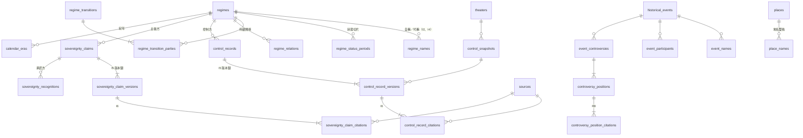

# PRD: World Line — 二戰第一階段

> 本專案目前唯一的一份 PRD。2026-10-27 專案從頭重建，舊程式碼與舊文件已全部移除；跨階段共用的技術選型、資料模型、API 慣例、UI 共通規格都寫在本檔。日後新階段（二戰深化、近代、古代）若另開 PRD，應從本檔抽出共用部分，不得與本檔矛盾。
>
> **業務規則以憲法為準**（`.claude/constitutions/world-line.md`，以下「憲法」）。本檔引用條文號（R#、I#、§#），不重寫規則本身；兩者衝突時以憲法為準。
>
> **標記慣例**：
> - 「使用者明示」：使用者原話或明確選擇。
> - 「使用者 2026-10-02 選定」：grill-me 當時在 PRD 層拍板的工程決策，重建後仍適用。
> - 「AI 提案・待拍板」：AI 推論出的設計，使用者確認前不可當成定案。
> - `TODO`：查不到資訊或尚未決定，禁止實作者自行腦補。

## 1. 背景 (Background)

- **產品初衷**（憲法 §1、§7 Decision 1）：傳統書本以單一視角、按時間拆解歷史；World Line 用 GIS 地圖讓人「縱覽世界」，同時看到多個政權並存（R2），也能聚焦單一政權，看它和同時期其他政權的互動（R3）。
- **為什麼第一階段是二戰**（憲法 §7 Decision 2）：古代史料（魏、蜀漢疆域）在三個管道都拿不到可用資料，所以「換起點，不換產品」，改成由近而遠、依史料可得性往回推。二戰是「多政權同時並存、跨洲互動」的極端案例，也最能驗證 R2、R3、R6。
- **2026-10-27 史料調查的結論**（`docs/research/ww2-data-sources.md`，以下「史料調查」）：
  - 主權軸可行，但沒有任何一份現成資料集能直接用，必須「開放資料骨架＋逐筆人工補來源」（I6、R7）。
  - 控制軸做「全球逐月」在來源上就不存在。有公有領域來源支撐的「戰區 × 月」只有約 25–35%。因此改成**事件驅動快照**，快照日期由來源決定（憲法 §9），全球約 150–250 個快照，估計 400–800 小時。
  - 中國戰區、東非、中東、法屬印度支那、泰國的控制資料缺口很大。這些戰區第一階段只做主權，控制以「控制資料缺」呈現（憲法 §1、R9）。
- **2026-10-27 從頭重建**：舊 schema、舊 API、三國資料都已移除，本檔的資料模型是全新設計，不是 migration。

## 2. 目標 (Goals)

- **業務目標**
  - 把時間軸拖到 1937-07～1945-09 的任一天，全球各政權的主權狀態同時呈現（R2、§1「主權軸全球都要有」）。
  - 有合格來源的戰區與時期，呈現實際控制；沒有合格來源的，以「控制資料缺」誠實呈現（R6、R9）。
  - 每筆主權、控制資料都能點開看到來源，含圖集與圖號／頁碼（I6、R7）。
  - 以 1940-07 法國為第一個完整試做案例（史料調查 §4），驗證資料模型與建置流程，再依 §10 里程碑擴張。
- **技術目標**（AI 提案・待拍板，使用者未給數字）
  - `TODO`：拖動時間軸時地圖更新的流暢度門檻。AI 提案：快照之間的拖動在前端完成、不逐幀打 API；跨到需要新資料的區段時，載入時間 < 1 秒（本機 Docker 環境）。
  - `TODO`：單次 `GET /control?date=` 回應大小上限。AI 提案：簡化後 ≤ 5 MB；超過就啟動 §11 的向量圖磚追蹤項。
  - I1–I6 每一條都有自動化測試覆蓋（integration test，以 Testcontainers 跑真實 PostGIS）。
- **使用者目標**（第一階段唯一使用者＝開發者本人，憲法 §2）
  - 不用教學就能完成：拖時間 → 看控制區 → 切主權 → 點政權看互動 → 點事件看多視角。
  - 任何畫面上都能分辨三件事：「這是史料還是推估」「這裡是有控制資料還是資料缺」「這個觀點的來源是什麼」（§9、R9、R8）。

## 3. 範圍 (Scope) vs 非範圍 (Non-Goals)

### ✅ 範圍

- [ ] **時間與空間**：1937-07～1945-09，全球所有戰區。1931 年起的相關資料（如滿洲國）可往前檢視，但不保證完整（憲法 §1 第一階段範圍）。
- [ ] **層級**：國家／控制區層級（R1，以及 R1 的二戰補充）。
- [ ] **多政權並存**：同一時間全球政權同時呈現（R2）。
- [ ] **政權聚焦**：聚焦單一政權，查看它在該時段與其他政權的互動，包括離散事件與持續關係（R3、§6「政權間互動」）。
- [ ] **雙語**：中文（繁體）與英文，範圍涵蓋介面與領域內容（政權名稱、事件敘事、爭議點）。資料結構可擴充，但第一階段只支援這兩種語言（R4）。
- [ ] **只交付政治／軍事維度**（R5）。
- [ ] **主權／實際控制兩軸**（R6）：
  - 主權主張可多筆並存，每筆標主張方與承認方；預設呈現「實際生效」那一筆，其餘以多重視角或爭議並存呈現，系統不裁判正當性。
  - 控制紀錄分五種類型：直接統治、軍事佔領、傀儡代管、不完全控制、交戰中。同一地區同一時間可有多筆。
  - 地圖預設呈現實際控制，可切換到主權檢視（使用者 2026-10-02 選定）。
- [ ] **戰線**：由敵對控制區的共同邊界推導，不另外存成實體（R6、§6「戰線」）。由後端 PostGIS 計算（使用者 2026-10-02 選定）。
- [ ] **史料來源政策**（R7、I6）：每筆主權主張與控制紀錄都必須附來源引用。控制軸只用有明確出版者、屬於公有領域或 CC 授權的地圖，並標出圖集與圖號／頁碼；只標「自製」的來源不採用。
- [ ] **控制資料缺**（R9、§6）：沒有合格來源的地區與時間，地圖上以獨立樣式呈現，不可用任何一種控制類型代替。
- [ ] **史料快照與推估過渡**（§9、§6）：
  - 快照日期由來源決定。
  - 時間軸可拖到任意日期；快照之間呈現連續變化，但推估狀態必須明確標示，並可得知最近的史料快照日期。
- [ ] **政權狀態機**（§4）：涵蓋存續、分裂、被取代（禪讓）、被滅亡、流亡、被併吞、復國，並記錄傳承關係鏈。佔領不改變政權狀態；投降、停戰以事件記錄。政權是否終止有爭議者，記錄為爭議點。
- [ ] **政權命名機制**（§6）：以自稱為主；聚焦某個政權的視角時，改用該視角的代稱，且代稱可連回自稱本體（I2、I4）。
- [ ] **地名雙軌**（§6「地名」）：顯示當時地名，括號附現代地名。
- [ ] **紀年**（§9）：以西元為主，保留各國紀年（如昭和、民國）。模糊或爭議日期允許以區間表示。
- [ ] **歷史事件與多重視角**（R8）：
  - 重大戰役、政治事件、暴行事件（如南京大屠殺、猶太大屠殺）第一階段就納入。
  - 有學術爭議的數字、命名、定性，以多觀點並列；每個觀點都必須有合格史料。
  - 否認論不入列：程式只強制「有引用」，「合格與否」由人工審查（見 §6 規則落點表）。
- [ ] **時代起訖爭議**：「二戰起點」（1931-09-18／1937-07-07／1939-09-01）以爭議點並列，系統不裁定（§9）。
- [ ] **史料修正**：所有疆域與政權資料的修正都保留原始版本、修改時間戳與修改原因，不覆蓋、不刪除（I5、§8）。
- [ ] **開發者寫入**：開發者以 API Key 寫入與修正資料，一般使用者唯讀（§2）。第一階段只有開發者一個使用者，資料建置工具的形式見 §8.10（待拍板）。

### ❌ 非範圍（明確不做，避免 scope creep）

**永久排除**（憲法 §1）
- ❌ 遊戲化或虛構劇情。
- ❌ 未來推測，包括臆測或未發生的假設互動（§6「政權間互動」的「不是」欄）。

**階段性延後，非永久排除**
- ❌ 史前歷史（§1、§6「史前歷史」判準）。
- ❌ 戰線層級（獨立描繪的週級戰線、軍團／集團軍級進軍箭頭）與部隊層級（師級軌跡、日級精度），屬二戰深化階段（R1）。
- ❌ 「點線佔領」的點、線建模（城市 Point＋鐵路 LineString）。第一階段只在有合格來源時以「不完全控制」多邊形概括，屬二戰深化階段。
- ❌ 政治／軍事以外的第二個歷史維度，以及維度切換器（R5）。資料表也不預留 `dimension` 欄位，避免為未來預留能力。
- ❌ 城市層級的發展（R1）。
- ❌ 中英文以外的語言（R4）。
- ❌ 教育對象的唯讀帳號、公開部署與多使用者權限。第一階段唯一使用者是開發者本人（§2）。
- ❌ 深色模式（使用者明示：淺色、不做深色模式）。
- ❌ 向量資料庫。日後若要語意搜尋，以 pgvector 評估（§11）。
- ❌ Redis（第一階段不加，觸發條件見 §11）。
- ❌ 向量圖磚（PMTiles／Martin），觸發條件見 §11。
- ❌ Deck.gl。綁定部隊層級軌跡的需求，屬二戰深化階段（grill-me 2026-10-02 結論）。
- ❌ 二戰以後（1945-09 之後）的資料，例如波羅的海三國到 1991 的狀態、戰後佔領期細節。
- ❌ 由系統裁判主權正當性、「正統」或「正確起點」（R6、§6、§9）。
- ❌ 全文搜尋與語意搜尋。第一階段只做政權名稱篩選（§8.6，AI 提案）。

## 4. 使用者故事 (User Stories)

> 第一階段的使用者都是開發者本人（§2）。Story 1–8 是以瀏覽者身分操作，Story 9 是以資料建置者身分操作。

### Story 1：全球政權同時並存（R2、§1）

- **As a** 使用者
- **I want to** 把時間軸停在 1941-12-10
- **So that** 我能一次看到歐洲、北非、東線、太平洋、中國各方同時的狀態，不必一本一本書切換

**Acceptance Criteria**:
- [ ] Given 時間軸停在任一日期，when 地圖渲染，then 全球所有有資料的政權與控制區同時顯示，不需要選戰區。
- [ ] Given 某戰區在該日期沒有合格控制來源，when 以控制檢視渲染，then 該區顯示「控制資料缺」樣式，其他戰區照常顯示（R9）。
- [ ] Given 日期早於 1937-07-01 但晚於 1931-09-18，when 地圖渲染，then 照常顯示已建置的資料，並以提示標明「本時段資料不保證完整」（§1）。

### Story 2：實際控制與主權主張檢視（R6、R2）

- **As a** 使用者
- **I want to** 把時間軸拖到 1940-07-15
- **So that** 我能同時看到德國軍事佔領的法國北部、維琪直接統治的南部，並切換檢視「法國主權由誰主張、誰承認」

**Acceptance Criteria**:
- [ ] Given 時間軸停在 1940-07-15，when 以預設（控制）檢視渲染，then 依控制紀錄著色，全球控制區同時顯示（R2）。
- [ ] Given 使用者切換到主權檢視，when 地圖渲染，then 依「實際生效」的主權主張著色；點擊某地區時，列出該地區該日期所有並存的主權主張，以及各自的承認方與不承認方（R6）。
- [ ] Given 某控制紀錄的類型是「不完全控制」或「交戰中」，when 地圖渲染，then 以斜線網底呈現，與完整掌控（實心色塊）明確區分（使用者 2026-10-02 選定：網底＝非完整掌控）。
- [ ] Given 同一地區同一時間有兩筆控制紀錄（例：雙方都是「不完全控制」），when 地圖渲染，then 兩方都看得到，不會只顯示其中一筆（R6）。
- [ ] Given 兩個敵對控制區相鄰，when 地圖渲染，then 顯示後端推導的戰線（R6、§6「戰線」）。

### Story 3：史料快照與推估過渡（§9、§6）

- **As a** 使用者
- **I want to** 拖動時間軸經過 1941-08～1941-09（基輔包圍戰）
- **So that** 我能看到控制區連續變化，同時清楚知道哪些畫面是史料、哪些是系統推估

**Acceptance Criteria**:
- [ ] Given 時間軸停在某戰區某個史料快照的日期，when 地圖渲染，then 該戰區以「史料」樣式呈現，並可點開查看快照的來源引用（I6）。
- [ ] Given 時間軸停在某戰區兩個快照之間，when 地圖渲染，then 該戰區以「推估」樣式呈現，並標示「推估過渡」及前後最近的史料快照日期。
- [ ] Given 時間軸持續拖動，when 跨過快照日期，then 呈現連續變化、不離散跳轉，只有呈現樣式在史料與推估之間切換（§9）。具體插值方式見 §12 Q3。
- [ ] Given 不同戰區的快照日期不同，when 時間軸停在某日，then 每個戰區各自判斷史料或推估，不會因為某一戰區有快照，就把全球標成史料。
- [ ] Given 某戰區在該日期之後已經沒有快照，when 時間軸停在最後一個快照之後，then `TODO`：是顯示「控制資料缺」還是延續最後狀態並標推估（AI 提案：在該控制紀錄 `valid_period` 內延續並標推估，超出 `valid_period` 就顯示控制資料缺）。

### Story 4：控制資料缺（R9）

- **As a** 使用者
- **I want to** 把時間軸停在 1940-10（義屬東非、英屬索馬利蘭）
- **So that** 我知道這裡第一階段沒有合格的控制來源，而不會誤以為這裡是「不完全控制」

**Acceptance Criteria**:
- [ ] Given 某地區某日期沒有任何控制紀錄，when 以控制檢視渲染，then 以「控制資料缺」樣式呈現。這個樣式與五種控制類型（含斜線網底）視覺上都明確不同。
- [ ] Given 使用者點擊控制資料缺的區域，when 開啟詳情，then 顯示「控制資料缺」的說明。若該區有涵蓋備註，一併顯示原因，例如「已調查，無合格來源」或「尚未建置」（依 §12 Q1 拍板結果）。
- [ ] Given 同一地區切換到主權檢視，when 渲染，then 照常顯示主權主張（§1：主權軸全球都要有）。
- [ ] Given 開發者寫入控制紀錄，when 嘗試以任何控制類型（尤其是「不完全控制」）填補沒有來源的區域，then 因為沒有合格引用而被拒絕（I6）。「控制資料缺」不是可寫入的控制類型（§6）。

### Story 5：近代政權狀態轉換（§4）

- **As a** 使用者
- **I want to** 查看波蘭（1939 流亡倫敦）與奧地利（1938 被併吞、1945 復國）的政權狀態
- **So that** 我能分辨「流亡」「被併吞」「被滅亡」「被佔領」這幾種處境

**Acceptance Criteria**:
- [ ] Given 某政權在該日期的狀態是「流亡」，when 顯示該政權，then 標示為流亡，且該政權仍可作為主權主張方出現（R6）。
- [ ] Given 某政權以「被併吞」進入非存續狀態，when 顯示狀態，then 在視覺與文字上都和「被滅亡」明確區分（§4：被併吞與被滅亡是兩種轉換）。
- [ ] Given 某政權由流亡或被併吞恢復為存續（復國），when 時間軸跨過復國日期，then 狀態轉換正確呈現。
- [ ] Given 某政權只是被軍事佔領，when 顯示狀態，then 政權狀態仍是「存續」，佔領只呈現在控制軸（§4「不屬於政權狀態的情況」）。
- [ ] Given 政權是否終止有爭議（例：納粹德國 1945），when 顯示，then 以爭議點並列，狀態機不裁定（§4）。

### Story 6：政權聚焦與互動（R3、§6「政權間互動」、§6「政權命名機制」）

- **As a** 使用者
- **I want to** 在 1942-06 點選日本，聚焦這個政權
- **So that** 我能看到它當時的控制區、主權主張、同盟與交戰對象、相關事件，並以它的視角看其他政權的稱呼

**Acceptance Criteria**:
- [ ] Given 使用者點選某政權的區塊，when 開啟聚焦面板，then 顯示：自稱名稱（含原文）、當日狀態、當日控制區、主權主張、當日有效的持續關係（同盟、交戰等）、時間窗內的離散事件、傳承關係（前身、後繼、消滅方或併吞方）。
- [ ] Given 進入聚焦模式，when 地圖渲染其他政權的標籤，then 若聚焦政權對該政權有代稱紀錄，改用代稱並保留回連自稱本體；沒有代稱紀錄就顯示自稱（§6 命名機制、I4）。
- [ ] Given 聚焦政權，when 地圖渲染，then 聚焦政權與互動對象突出，其他政權淡化，但仍可見（R2 不被聚焦破壞）。
- [ ] Given 退出聚焦，when 地圖渲染，then 回到全球視角，標籤回到自稱。

### Story 7：爭議與暴行事件的多視角邊界（R8、§9）

- **As a** 使用者
- **I want to** 查看南京大屠殺的事件詳情
- **So that** 我能看到有學術依據的不同傷亡估計並列，而不會看到否認論被當成同等觀點

**Acceptance Criteria**:
- [ ] Given 事件有多個傷亡估計觀點，when 顯示爭議點區塊，then 各觀點並列，每個觀點都附合格史料引用。
- [ ] Given 一筆觀點沒有任何來源引用，when 透過 API 寫入，then 被拒絕（R8）。來源是否「合格」（§6 判準）無法由程式判斷，由資料建置者在建置時審查，API 層不假裝能驗證。
- [ ] Given 事件本身已由史料確立，when 顯示，then 不提供「是否發生」的並列觀點（R8：已確立事實不開放並列）。
- [ ] Given 事件「第二次世界大戰」，when 顯示起點，then 1931-09-18、1937-07-07、1939-09-01 三種起點以爭議點並列，系統不標示任何一者為正確（§9）。
- [ ] Given 同一事件在不同政權有不同命名，when 聚焦某政權，then 事件標題改用該視角的命名，並可看到其他命名（§6 命名機制套用到事件，AI 提案）。

### Story 8：雙語、紀年與地名（R4、§9、§6「地名」）

- **As a** 使用者
- **I want to** 切換到英文，並在聚焦日本時看到昭和紀年、在地圖上看到當時地名
- **So that** 換語言後內容不會停在單一語言，也能用當時的時間與地名理解歷史

**Acceptance Criteria**:
- [ ] Given 使用者切換語言，when 畫面更新，then 介面文字與領域內容（政權名稱、事件敘事、爭議點）一起切換，不需重新整理頁面（R4）。
- [ ] Given 某筆內容缺少目前語言的翻譯，when 顯示，then `TODO`（依 §12 Q8）。AI 提案：顯示另一語言並加「未翻譯」標記，不顯示空白。
- [ ] Given 時間軸停在 1940-07-15，when 顯示日期，then 以西元為主，並依規則附上相關紀年，例如「昭和 15 年」「民國 29 年」（§9）。哪些紀年要顯示見 §12 Q9。
- [ ] Given 地圖顯示城市標籤，when 該城市當時名稱與現代不同，then 顯示「當時名稱（現代名稱）」，例如「新京（長春）」「列寧格勒（聖彼得堡）」「巴達維亞（雅加達）」（§6「地名」）。
- [ ] Given 日期是區間（例：自由法國取得新赫布里底，來源記為 1940-07-18 或 1940-07-22），when 顯示，then 以區間呈現並可看到各自的來源（§9「允許區間」）。

### Story 9：開發者建置與修正資料（§2、I1–I6、§8、R7）

- **As a** 開發者（資料建置者）
- **I want to** 把 QGIS 描好的 1940-07-15 法國控制區連同來源引用匯入，之後依新史料修正一筆紀錄
- **So that** 資料可以逐步累積，每次修正都保留原始版本與原因

**Acceptance Criteria**:
- [ ] Given 寫入主權主張或控制紀錄時沒有時間區間，when 呼叫 API，then 被拒絕（I1）。
- [ ] Given 建立政權時沒有自稱名稱，when 呼叫 API，then 被拒絕（I2）。
- [ ] Given 同一主張方、同一地區、同一時間已有一筆正式版本的主權主張，when 再寫入一筆矛盾且未標爭議並存的正式版本，then 被拒絕（I3）；控制紀錄同理（同一控制方）。不同主張方的主張並存則正常接受。
- [ ] Given 寫入代稱時指向不存在的政權，when 呼叫 API，then 被拒絕（I4）。
- [ ] Given 修正一筆紀錄，when 呼叫修正端點，then 必須提供修正原因；原始版本保留，可查詢修正歷程與時間戳。不可硬刪除，撤回也是一種版本（I5、§8）。
- [ ] Given 寫入主權主張或控制紀錄時沒有任何引用，when 呼叫 API，then 被拒絕（I6）。
- [ ] Given 控制紀錄的引用來源不是地圖類，或缺少圖號／頁碼，或授權不在允許清單內，when 呼叫 API，then 被拒絕（R7）。
- [ ] Given 來源只標「自製」、沒有出版者，when 建立來源，then 被拒絕（R7）。
- [ ] Given 沒有帶 API Key 或 API Key 錯誤，when 呼叫任何寫入端點，then 回 401（§2）。

## 5. 技術選型 (Tech Stack)

> 使用者明示：「沿用Angular，如果sanring-*系列的專案技術站可以用就直接參考」。版本取自 `/Users/jack755051/Project/sanring/sanring-middle-platform`（2026-10-27 實際讀取）。

| 層 | 選型 | 理由 |
|---|---|---|
| Frontend | **Angular 22.2**（`@angular/core` ^22.2.0）、TypeScript ~6.0.2、pnpm 11.22.0 | 使用者明示沿用 Angular；版本照 middle-platform |
| 前端無障礙／行為 | `@angular/aria` ^22.2.2、`@angular/cdk` ^22.2.2 | 照 middle-platform |
| UI 庫 | **sanring UI 元件**（`@sanring/cli` 0.30.2，以 `sanring.config.json` 安裝到 `src/app/components/ui`，元件程式碼 copy 進 repo） | 使用者明示。**只取結構與行為**；視覺用專案自有的 `--wl-*` token，風格刻意不同於 sanring 系列（見下方「視覺方向」） |
| CSS | **Tailwind CSS 4**（`tailwindcss` ^4.3.3、`@tailwindcss/postcss` ^4.3.3）＋ `clsx`、`tailwind-merge` | sanring 固定預設，版本照 middle-platform |
| Icon | Lucide（`@lucide/angular` ^1.57.0） | 照 middle-platform |
| 地圖 | **MapLibre GL JS** | 使用者明示。`TODO`：版本與 Angular 封裝方式（直接用 JS API，或包成 `shared/map` 元件，AI 提案後者） |
| API 型別 | `openapi-typescript` ^7.13.0，由 `backend/openapi/v1.json` 產生 `src/app/core/api-schema.ts`（`gen:api`、`check:api`） | 照 middle-platform 慣例 |
| 前端測試 | Vitest ^5、jsdom、Playwright ^1.64.1（E2E） | 照 middle-platform |
| Backend | **.NET 10**（`net10.0`）ASP.NET Core Web API，Minimal API endpoint 依 Feature 分資料夾 | 使用者明示；版本與結構照 middle-platform（`Features/*Endpoints.cs`、`Domain/`、`Infrastructure/`） |
| ORM | EF Core 10＋`Npgsql.EntityFrameworkCore.PostgreSQL` 10.0.3＋`EFCore.NamingConventions` 10.0.1（snake_case）＋**NetTopologySuite**（`Npgsql.EntityFrameworkCore.PostgreSQL.NetTopologySuite`） | 使用者明示。`TODO`：NTS 套件版本，需與 Npgsql EF 10.0.x 對齊 |
| OpenAPI | `Microsoft.AspNetCore.OpenApi` 10.0.x，輸出 `backend/openapi/v1.json` | 照 middle-platform。`TODO`：是否加互動式 API 文件 UI（Scalar 等），middle-platform 未見，未驗證 |
| 套件鎖定 | `Directory.Build.props`：`RestorePackagesWithLockFile=true`、`RuntimeIdentifiers=linux-x64;linux-arm64` | 照 middle-platform |
| 後端測試 | xUnit 2.9.3、`Microsoft.AspNetCore.Mvc.Testing`、`Testcontainers.PostgreSql` 4.16.0（改用 PostGIS image） | 照 middle-platform；I1–I6 必須用真實 PostGIS 測 |
| DB | **PostgreSQL＋PostGIS**（擴充：`postgis`、`btree_gist`） | 使用者明示。middle-platform 用 `postgres:18-alpine`，但 PostGIS 需要另外的 image。`TODO`：確認 PostgreSQL 18＋PostGIS 3.x 的官方 image tag（例 `postgis/postgis:18-3.x`，**未驗證**） |
| 向量 DB | **不用** | 使用者明示；日後語意搜尋以 pgvector 評估（§11） |
| Cache | **無**（第一階段不加 Redis） | 使用者明示「只在確定需要時才加」，觸發條件見 §11 |
| Auth | 讀取公開；寫入用 `X-API-Key` header（單一 key，存環境變數） | §2：只有開發者可寫。AI 提案・待拍板：key 的產生與輪替方式 |
| Deploy | **Docker Compose**（`compose.yaml`：`postgres`（PostGIS）＋`api`＋`web`），本機埠只綁 `127.0.0.1` | 照 middle-platform。`TODO`：第一階段是否需要對外部署（§2 第一階段只有開發者，AI 提案：只跑本機） |
| 監控 | ASP.NET Core Health Checks（`/healthz`，含 DB 檢查） | 照 middle-platform（`HealthChecks.EntityFrameworkCore`）。第一階段單人使用，不導入 Prometheus／OTel |
| 資料建置工具 | QGIS（地理配準、手描多邊形，匯出 GeoJSON）＋匯入腳本或匯入 API | 史料調查 §2、§4；建置 UI 是否需要見 §8.10 |

**目錄結構**（照 middle-platform，名稱為 AI 提案・待拍板）

```text
world_line/
├── compose.yaml
├── backend/
│   ├── WorldLine.slnx
│   ├── Directory.Build.props
│   ├── Dockerfile
│   ├── openapi/v1.json
│   ├── src/
│   │   ├── WorldLine.Api/          # Features/ Domain/ Infrastructure/（含 Migrations）
│   │   └── WorldLine.Contracts/    # request/response DTO
│   └── tests/
│       └── WorldLine.Api.Tests/
├── frontend/
│   ├── package.json  sanring.config.json
│   └── src/app/
│       ├── core/          # api client、api-schema.ts、i18n、狀態（Signals）
│       ├── layout/        # app shell、top bar
│       ├── pages/         # atlas（主地圖頁）、not-found
│       ├── shared/        # map、timeline、legend、citation 等領域元件
│       └── components/ui/ # sanring UI（CLI 安裝）
└── docs/research/
```

**前端狀態管理**（AI 提案・待拍板）：用 Angular Signals＋Service（`core/atlas-state`），管理 `date`、`axis`、`focusRegimeId`、`selectedEventId`、`lang`，並同步到 URL query string。第一階段單頁、狀態量小，不導入 NgRx。

**視覺方向**（使用者明示）：
- 「地圖集／檔案館」風格，淺色，不做深色模式。
- UI 退到背景，讓地圖上的政權色當主角。
- 視覺 token 一律用 `--wl-*`，風格刻意不同於 sanring 系列。
- 詳細規格留給 DESIGN.md，本檔 §8 只定畫面元素與狀態。

## 6. 資料模型 (Data Model)

### 6.1 設計原則

1. **主權與控制分兩組表**（使用者 2026-10-02 選定）：主張方、承認方等欄位對控制紀錄沒有意義，所以不採「單表加 axis 欄位」。
2. **時間一律用 `daterange`（半開區間 `[起, 迄)`）**（使用者 2026-10-02 選定改用日精度）。疆域資料兩端都必須有界（I1；「兩端必填」是 AI 提案）。模糊日期另外以 `start_uncertainty`／`end_uncertainty`（daterange）記錄可能範圍（§9「允許區間」，AI 提案）。
3. **多語文字用 JSONB**（AI 提案・待拍板，見 §12 Q8）：格式為 `{"zh-Hant": "...", "en": "..."}`，加語言時不必改 schema（R4「可擴充」），但第一階段只接受這兩個 key（應用層驗證）。原文另外存 `original_text`＋`original_lang`（BCP 47），對應 §6「以自稱為主」。
4. **「朝代／帝國／國家」不是欄位**（§6）：是觀察視角的產物，不存成政權屬性。
5. **狀態用時間切片**：政權狀態（存續、流亡、被併吞）隨時間變化，存在 `regime_status_periods`；轉換本身（分裂、禪讓、滅亡、流亡、併吞、復國、政體更替）是客觀事實，存在 `regime_transitions`（§4、§4 傳承關係鏈）。
6. **控制紀錄掛在「史料快照」底下**：每個快照屬於一個戰區，對應一個來源日期（§9「快照日期由來源決定」）。推估過渡在同戰區的相鄰快照之間計算，不另外存（§6「推估過渡不是史料」）。
7. **「控制資料缺」不是 `control_type` 的值**（R9、§6）：表達方式見 6.4，待拍板。
8. **I6 引用**：每類被引用的主體各有一張 citation 表（FK 完整性），格式一致：`source_id`＋`locator`（圖號／頁碼）＋`evidence_note`。
9. **I5 修正保留**（§12 Q2，2026-10-27 使用者交由 AI 決定，採方案 A）：主權主張與控制紀錄用「身分表＋版本表」，其他表用 `revision_log`＋軟撤回。理由：疆域修正歷程是最常被查詢的（例：某條界線因新史料改過幾次），值得獨立版本表；其餘資料修正頻率低，共用一張紀錄表即可。
10. **戰線不存表**：由 API 依日期即時推導（§6「戰線」）。
11. **只為第一階段建表**：史觀主線（§6「正式朝代」）第一階段是否建表標 `TODO`（6.6）；不預留第二維度欄位（R5）。

### 6.2 規則落點表（業務規則由誰強制）

| 規則 | DB constraint | 應用層（Domain／Feature） | 人工審查 |
|---|---|---|---|
| I1 時間區間 | `valid_period NOT NULL`＋兩端有界 CHECK | 請求驗證 | — |
| I2 自稱必填 | — | 建立政權必須同時帶至少一筆 `name_kind='self'`，同一 transaction | — |
| I3 同方不矛盾 | — | 寫入前查同主張方（或同控制方）、時間重疊、幾何相交面積 > 容差，且雙方都非 `is_disputed` 的現行版本 → 409。`TODO`：容差數值 | — |
| I4 代稱不孤兒 | `regime_id NOT NULL REFERENCES regimes` | — | — |
| I5 修正保留 | 版本表只能 INSERT；舊版本只允許更新 `superseded_by`／`superseded_at`（trigger） | 修正必須帶 `revision_reason`；不提供 DELETE | — |
| I6 引用必填 | — | 主權主張與控制紀錄的寫入請求必須帶 ≥1 筆 citation，同一 transaction 寫入 | 引用內容是否真的支撐該筆資料 |
| R7 來源政策 | `sources.publisher NOT NULL` | 控制紀錄的 primary citation 必須是地圖類來源、有 `locator`、授權在允許清單內 | 是否真為公有領域或 CC；「自製」判定 |
| R8 觀點須有合格史料 | — | 觀點寫入時必須帶 ≥1 筆 citation | **合格與否、否認論排除**（程式無法判斷） |
| R9 控制資料缺 | `control_type` CHECK 不含「缺」 | 缺口幾何由查詢推導（見 6.4） | — |
| §4 狀態機合法轉換 | — | `RegimeTransitionValidator`（Domain） | — |
| §4 被取代 ≠ 被滅亡 ≠ 被併吞 | `kind` CHECK 分成不同值 | — | — |

### 6.3 Schema（全新建立）

```sql
CREATE EXTENSION IF NOT EXISTS postgis;
CREATE EXTENSION IF NOT EXISTS btree_gist;
-- gen_random_uuid() 為 PostgreSQL 13+ 內建

-- ───────────────────────── 來源（R7） ─────────────────────────
CREATE TABLE sources (
  id UUID PRIMARY KEY DEFAULT gen_random_uuid(),
  source_kind VARCHAR(32) NOT NULL CHECK (source_kind IN (
    'map',              -- 單張地圖（例：Leconte 分界線圖）
    'atlas_map',        -- 圖集中的一張（例：West Point WWII Europe Map 15）
    'treaty',           -- 條約、協定原文（例：德法停戰協定）
    'official_record',  -- 官方紀錄、公報
    'trial_record',     -- 審判紀錄
    'peer_reviewed',    -- 經同行審查的研究
    'official_history', -- 官方戰史（例：CMH Green Books）
    'dataset'           -- 開放資料集（例：OHM、Département de l'Ain 分界線）
  )),                   -- AI 提案・待拍板：分類清單
  title TEXT NOT NULL,
  publisher TEXT NOT NULL,          -- R7：必須有明確出版者／出處；「自製」不可
  authors TEXT,
  published_text TEXT,              -- 出版日期原樣保留，允許區間（例：'1940–1943'）
  license_code VARCHAR(32),         -- 'us_federal_pd' | 'cc0' | 'cc_by' | 'cc_by_sa' | 'licence_ouverte_2' | 'pd_expired' | ...（AI 提案）
  license_evidence_url TEXT,        -- 授權依據頁（例：Commons 檔案頁、館方標示）
  url TEXT,
  archive_url TEXT,                 -- Wayback 等存檔
  local_copy_path TEXT,             -- 本機存檔路徑（史料調查 §5.5.6：West Point 圖檔要儘快存本地）
  catalog_id TEXT,                  -- 館藏號（例：2015.3.1.230）
  note TEXT,
  created_at TIMESTAMPTZ NOT NULL DEFAULT now(),
  updated_at TIMESTAMPTZ NOT NULL DEFAULT now(),
  version INT NOT NULL DEFAULT 0
);

-- ───────────────────────── 政權（§4、§6、I2、I4、R4） ─────────────────────────
CREATE TABLE regimes (
  id UUID PRIMARY KEY DEFAULT gen_random_uuid(),
  slug VARCHAR(80) NOT NULL UNIQUE,     -- 例：'french-state-vichy'
  wikidata_qid VARCHAR(20),             -- 回查用（OHM 有 341 筆帶 wikidata）
  retracted_at TIMESTAMPTZ,             -- I5：不硬刪，只撤回
  retraction_reason TEXT,
  created_at TIMESTAMPTZ NOT NULL DEFAULT now(),
  updated_at TIMESTAMPTZ NOT NULL DEFAULT now(),
  version INT NOT NULL DEFAULT 0
);

CREATE TABLE regime_names (
  id UUID PRIMARY KEY DEFAULT gen_random_uuid(),
  regime_id UUID NOT NULL REFERENCES regimes(id),          -- I4：代稱一定回連本體
  name_kind VARCHAR(8) NOT NULL CHECK (name_kind IN ('self', 'exonym')),
  original_text TEXT NOT NULL,                             -- 原文，例：'État français'、'大日本帝國'
  original_lang VARCHAR(16) NOT NULL,                      -- BCP 47，例：'fr'、'ja'
  display JSONB NOT NULL,                                  -- 翻譯／呈現：{"zh-Hant": "...", "en": "..."}（R4）
  observer_regime_id UUID REFERENCES regimes(id),          -- 代稱：哪個政權的視角使用此稱呼
  valid_period DATERANGE,                                  -- 名稱使用期間；NULL＝政權存續全程
  is_primary BOOLEAN NOT NULL DEFAULT FALSE,               -- 同類型內的預設名稱
  retracted_at TIMESTAMPTZ, retraction_reason TEXT,
  created_at TIMESTAMPTZ NOT NULL DEFAULT now(),
  version INT NOT NULL DEFAULT 0,
  CHECK (name_kind = 'self' OR observer_regime_id IS NOT NULL),   -- AI 提案：代稱必須標視角
  CHECK (jsonb_typeof(display) = 'object')
);
-- I2：建立政權時至少一筆 name_kind='self'（應用層，同一 transaction）

-- 陣營時間切片（憲法 §6「陣營」，2026-10-28 拍板）：地圖配色依此決定色系
CREATE TABLE regime_alignments (
  id UUID PRIMARY KEY DEFAULT gen_random_uuid(),
  regime_id UUID NOT NULL REFERENCES regimes(id),
  camp VARCHAR(16) NOT NULL CHECK (camp IN ('axis', 'allies', 'co_belligerent', 'neutral')),
  valid_period DATERANGE NOT NULL,                          -- 起點＝條約簽署／參戰日
  basis_event_id UUID,                                      -- 依據事件（例：三國同盟條約簽署），FK 於 historical_events 建立後加上
  retracted_at TIMESTAMPTZ, retraction_reason TEXT,
  created_at TIMESTAMPTZ NOT NULL DEFAULT now(),
  version INT NOT NULL DEFAULT 0,
  EXCLUDE USING gist (regime_id WITH =, valid_period WITH &&) WHERE (retracted_at IS NULL)
);
-- 每筆須附引用（regime_alignment_citations，格式同其他 citation 表），應用層強制
-- 沒有 alignment 紀錄的政權，前端以「中立／未結盟」色系呈現並標示「未建置」

-- 政權狀態時間切片：存續／流亡／被併吞（§4）
CREATE TABLE regime_status_periods (
  id UUID PRIMARY KEY DEFAULT gen_random_uuid(),
  regime_id UUID NOT NULL REFERENCES regimes(id),
  status VARCHAR(16) NOT NULL CHECK (status IN ('active', 'exiled', 'annexed')),
  valid_period DATERANGE NOT NULL,
  start_uncertainty DATERANGE,
  end_uncertainty DATERANGE,
  retracted_at TIMESTAMPTZ, retraction_reason TEXT,
  created_at TIMESTAMPTZ NOT NULL DEFAULT now(),
  version INT NOT NULL DEFAULT 0,
  EXCLUDE USING gist (regime_id WITH =, valid_period WITH &&) WHERE (retracted_at IS NULL)
);
-- 政權終止（被滅亡、被取代、分裂）之後沒有切片；終止方式由 regime_transitions 表達

-- 狀態轉換（§4 合法轉換＋傳承關係鏈）
CREATE TABLE regime_transitions (
  id UUID PRIMARY KEY DEFAULT gen_random_uuid(),
  kind VARCHAR(16) NOT NULL CHECK (kind IN (
    'split',       -- 分裂
    'replaced',    -- 被取代（禪讓）——與 destroyed 不可合併（§4）
    'destroyed',   -- 被滅亡
    'exiled',      -- 流亡
    'annexed',     -- 被併吞——與 destroyed 不可合併（§4）
    'restored',    -- 復國（流亡／被併吞 → 存續）
    'regime_change' -- 政體更替（憲法 §4，2026-10-27 拍板）——與 replaced 不可合併
  )),
  occurred DATERANGE NOT NULL,                              -- 允許區間（§9）
  event_id UUID,                                            -- 觸發事件（FK 於 historical_events 建立後加上）
  note JSONB,
  retracted_at TIMESTAMPTZ, retraction_reason TEXT,
  created_at TIMESTAMPTZ NOT NULL DEFAULT now(),
  version INT NOT NULL DEFAULT 0
);

CREATE TABLE regime_transition_parties (
  transition_id UUID NOT NULL REFERENCES regime_transitions(id),
  regime_id UUID NOT NULL REFERENCES regimes(id),
  role VARCHAR(16) NOT NULL CHECK (role IN (
    'subject',      -- 狀態改變的政權（流亡、被併吞、復國）
    'predecessor',  -- 前身（分裂、禪讓）
    'successor',    -- 後繼（分裂、禪讓）
    'terminator'    -- 消滅方／併吞方（§4：被滅亡須記錄消滅方）
  )),
  PRIMARY KEY (transition_id, regime_id, role)
);
-- 合法性（例：split 必須 1 前身 ≥2 後繼；destroyed 必須有 terminator）由 RegimeTransitionValidator 驗證

-- 持續關係（§6「政權間互動」(2)；戰線推導的「敵對」依據）
CREATE TABLE regime_relations (
  id UUID PRIMARY KEY DEFAULT gen_random_uuid(),
  regime_a_id UUID NOT NULL REFERENCES regimes(id),
  regime_b_id UUID NOT NULL REFERENCES regimes(id),
  relation_type VARCHAR(24) NOT NULL CHECK (relation_type IN (
    'at_war', 'alliance', 'non_aggression_pact', 'patron_puppet', 'trade'
  )),                                                       -- AI 提案・待拍板（§12 Q6）
  valid_period DATERANGE NOT NULL,
  start_uncertainty DATERANGE, end_uncertainty DATERANGE,
  note JSONB,
  retracted_at TIMESTAMPTZ, retraction_reason TEXT,
  created_at TIMESTAMPTZ NOT NULL DEFAULT now(),
  version INT NOT NULL DEFAULT 0,
  CHECK (regime_a_id <> regime_b_id)
);
CREATE INDEX ix_regime_relations_period ON regime_relations USING gist (valid_period);

-- ───────────────────────── 戰區與史料快照（§9） ─────────────────────────
CREATE TABLE theaters (
  id UUID PRIMARY KEY DEFAULT gen_random_uuid(),
  code VARCHAR(40) NOT NULL UNIQUE,                         -- 例：'west-europe'、'eastern-front'、'china'
  name JSONB NOT NULL,
  extent GEOMETRY(MultiPolygon, 4326),                      -- TODO：戰區範圍是否必須互不重疊（§12 Q5）
  created_at TIMESTAMPTZ NOT NULL DEFAULT now()
);

CREATE TABLE control_snapshots (
  id UUID PRIMARY KEY DEFAULT gen_random_uuid(),
  theater_id UUID NOT NULL REFERENCES theaters(id),
  as_of DATE NOT NULL,                                      -- 來源地圖所呈現的日期（§9 快照日期由來源決定）
  as_of_note JSONB,                                         -- 例：「圖上標示 13–25 June，取 25 June」
  attestation VARCHAR(8) NOT NULL DEFAULT 'point'
    CHECK (attestation IN ('point', 'interval')),           -- §12 Q4 已拍板（憲法 §6「史料快照」：來源明文確立整段期間時允許 interval）
  attested_period DATERANGE,                                -- 僅 interval：來源本身確立的整段期間（例：停戰協定分界線 1940-06-22～1942-11-11）
  title JSONB,
  created_at TIMESTAMPTZ NOT NULL DEFAULT now(),
  UNIQUE (theater_id, as_of),
  CHECK ((attestation = 'interval') = (attested_period IS NOT NULL))
);

-- ───────────────────────── 控制軸（R6、I1、I3、I5、I6） ─────────────────────────
-- 方案 A（§12 Q2 已拍板）：身分表＋版本表
CREATE TABLE control_records (
  id UUID PRIMARY KEY DEFAULT gen_random_uuid(),            -- 穩定身分，跨版本不變
  controller_regime_id UUID NOT NULL REFERENCES regimes(id),
  created_at TIMESTAMPTZ NOT NULL DEFAULT now()
);

CREATE TABLE control_record_versions (
  id UUID PRIMARY KEY DEFAULT gen_random_uuid(),
  control_record_id UUID NOT NULL REFERENCES control_records(id),
  snapshot_id UUID NOT NULL REFERENCES control_snapshots(id),
  control_type VARCHAR(24) NOT NULL CHECK (control_type IN (
    'direct_rule',            -- 直接統治
    'military_occupation',    -- 軍事佔領
    'puppet_administration',  -- 傀儡代管
    'partial',                -- 不完全控制
    'contested'               -- 交戰中
  )),                         -- R9：「控制資料缺」刻意不在此清單
  patron_regime_id UUID REFERENCES regimes(id),             -- 傀儡代管的扶植方（AI 提案・待拍板 §12 Q7）
  valid_period DATERANGE NOT NULL
    CHECK (NOT lower_inf(valid_period) AND NOT upper_inf(valid_period)),  -- I1
  start_uncertainty DATERANGE,
  end_uncertainty DATERANGE,
  geom GEOMETRY(MultiPolygon, 4326) NOT NULL CHECK (ST_IsValid(geom)),
  is_disputed BOOLEAN NOT NULL DEFAULT FALSE,               -- I3 例外：明確標記爭議並存
  is_retraction BOOLEAN NOT NULL DEFAULT FALSE,             -- I5：撤回也是一個版本
  revision_reason TEXT,                                     -- 第一版可空，之後的版本必填（應用層）
  superseded_by UUID REFERENCES control_record_versions(id),
  superseded_at TIMESTAMPTZ,
  created_at TIMESTAMPTZ NOT NULL DEFAULT now()
);
CREATE INDEX ix_crv_current_period ON control_record_versions USING gist (valid_period) WHERE superseded_by IS NULL;
CREATE INDEX ix_crv_current_geom   ON control_record_versions USING gist (geom)         WHERE superseded_by IS NULL;
-- trigger：舊版本只允許寫入 superseded_by / superseded_at（I5）

CREATE TABLE control_record_citations (
  control_record_version_id UUID NOT NULL REFERENCES control_record_versions(id),
  source_id UUID NOT NULL REFERENCES sources(id),
  locator TEXT NOT NULL,                                    -- R7：圖集＋圖號／頁碼，例：'WWII Europe Map 15'
  role VARCHAR(24) NOT NULL DEFAULT 'primary'
    CHECK (role IN ('primary', 'auxiliary_geometry', 'date_check')),  -- 例：Ain 分界線＝auxiliary_geometry（史料調查 §4.3.4）
  evidence_note TEXT NOT NULL,
  PRIMARY KEY (control_record_version_id, source_id, locator)
);
-- I6＋R7：每個版本 ≥1 筆 role='primary' 且來源為地圖類（應用層）

-- ───────────────────────── 主權軸（R6、I3、I5、I6） ─────────────────────────
CREATE TABLE sovereignty_claims (
  id UUID PRIMARY KEY DEFAULT gen_random_uuid(),
  claimant_regime_id UUID NOT NULL REFERENCES regimes(id),  -- 主張方
  created_at TIMESTAMPTZ NOT NULL DEFAULT now()
);

CREATE TABLE sovereignty_claim_versions (
  id UUID PRIMARY KEY DEFAULT gen_random_uuid(),
  sovereignty_claim_id UUID NOT NULL REFERENCES sovereignty_claims(id),
  valid_period DATERANGE NOT NULL
    CHECK (NOT lower_inf(valid_period) AND NOT upper_inf(valid_period)),  -- I1
  start_uncertainty DATERANGE,
  end_uncertainty DATERANGE,
  geom GEOMETRY(MultiPolygon, 4326) NOT NULL CHECK (ST_IsValid(geom)),
  is_effective BOOLEAN NOT NULL DEFAULT FALSE,              -- 當時實際生效（主權檢視預設著色依據，R6）
  is_disputed BOOLEAN NOT NULL DEFAULT FALSE,               -- I3 例外
  is_retraction BOOLEAN NOT NULL DEFAULT FALSE,
  revision_reason TEXT,
  superseded_by UUID REFERENCES sovereignty_claim_versions(id),
  superseded_at TIMESTAMPTZ,
  created_at TIMESTAMPTZ NOT NULL DEFAULT now()
);
CREATE INDEX ix_scv_current_period ON sovereignty_claim_versions USING gist (valid_period) WHERE superseded_by IS NULL;
CREATE INDEX ix_scv_current_geom   ON sovereignty_claim_versions USING gist (geom)         WHERE superseded_by IS NULL;
-- 「實際生效」在個案有爭議時，以 event_controversies 逐案記錄，不建通則（R6）
-- TODO：同一地點同一時間出現兩筆 is_effective 時的處理（應用層警告或拒絕，§12 Q12）

CREATE TABLE sovereignty_claim_citations (
  sovereignty_claim_version_id UUID NOT NULL REFERENCES sovereignty_claim_versions(id),
  source_id UUID NOT NULL REFERENCES sources(id),
  locator TEXT NOT NULL,
  role VARCHAR(24) NOT NULL DEFAULT 'primary'
    CHECK (role IN ('primary', 'auxiliary_geometry', 'date_check')),  -- 例：OHM 幾何＝auxiliary_geometry、CShapes 只核對日期＝date_check
  evidence_note TEXT NOT NULL,
  PRIMARY KEY (sovereignty_claim_version_id, source_id, locator)
);

-- 承認方（承認本身有時間性，例：美國對波羅的海併入的不承認政策）
CREATE TABLE sovereignty_recognitions (
  id UUID PRIMARY KEY DEFAULT gen_random_uuid(),
  sovereignty_claim_id UUID NOT NULL REFERENCES sovereignty_claims(id),  -- 指向身分，修正幾何不影響承認紀錄
  recognizer_regime_id UUID NOT NULL REFERENCES regimes(id),
  stance VARCHAR(16) NOT NULL CHECK (stance IN ('recognized', 'not_recognized')),
  valid_period DATERANGE NOT NULL,
  start_uncertainty DATERANGE, end_uncertainty DATERANGE,
  retracted_at TIMESTAMPTZ, retraction_reason TEXT,
  created_at TIMESTAMPTZ NOT NULL DEFAULT now(),
  version INT NOT NULL DEFAULT 0
);
CREATE TABLE sovereignty_recognition_citations (
  sovereignty_recognition_id UUID NOT NULL REFERENCES sovereignty_recognitions(id),
  source_id UUID NOT NULL REFERENCES sources(id),
  locator TEXT NOT NULL,
  evidence_note TEXT NOT NULL,
  PRIMARY KEY (sovereignty_recognition_id, source_id, locator)
);

-- ───────────────────────── 控制資料缺的表達（R9，待拍板 §12 Q1，見 6.4） ─────────────────────────
-- 陸地遮罩：計算「沒有控制紀錄的陸地」用（Natural Earth，公有領域）
CREATE TABLE reference_land (
  id SERIAL PRIMARY KEY,
  geom GEOMETRY(MultiPolygon, 4326) NOT NULL,
  source_id UUID NOT NULL REFERENCES sources(id)
);
CREATE INDEX ix_reference_land_geom ON reference_land USING gist (geom);

-- 僅選項 B／C 需要：涵蓋備註（不產生任何控制類型，只說明缺的原因）
CREATE TABLE control_coverage_notes (
  id UUID PRIMARY KEY DEFAULT gen_random_uuid(),
  theater_id UUID REFERENCES theaters(id),
  geom GEOMETRY(MultiPolygon, 4326) NOT NULL,
  valid_period DATERANGE NOT NULL,
  reason VARCHAR(24) NOT NULL CHECK (reason IN ('no_qualified_source', 'not_yet_digitized')),
  note JSONB,
  research_ref TEXT,                                        -- 例：'docs/research/ww2-data-sources.md §2.7'
  retracted_at TIMESTAMPTZ, retraction_reason TEXT,
  created_at TIMESTAMPTZ NOT NULL DEFAULT now(),
  version INT NOT NULL DEFAULT 0
);

-- ───────────────────────── 事件、命名、爭議（R8、§6、§9） ─────────────────────────
CREATE TABLE historical_events (
  id UUID PRIMARY KEY DEFAULT gen_random_uuid(),
  event_kind VARCHAR(16) NOT NULL CHECK (event_kind IN (
    'war', 'campaign', 'battle', 'treaty', 'armistice', 'surrender', 'political', 'atrocity'
  )),                                                       -- AI 提案・待拍板
  parent_event_id UUID REFERENCES historical_events(id),   -- 例：會戰屬於某戰役
  summary JSONB,                                            -- 事件敘事（R4 雙語）
  occurred DATERANGE NOT NULL,                              -- 允許區間（§9）
  date_precision VARCHAR(8) NOT NULL CHECK (date_precision IN ('day', 'month', 'year')),
  location GEOMETRY(Geometry, 4326),
  place_id UUID,                                            -- FK 於 places 建立後加上
  retracted_at TIMESTAMPTZ, retraction_reason TEXT,
  created_at TIMESTAMPTZ NOT NULL DEFAULT now(),
  updated_at TIMESTAMPTZ NOT NULL DEFAULT now(),
  version INT NOT NULL DEFAULT 0
);
CREATE INDEX ix_events_occurred ON historical_events USING gist (occurred);
ALTER TABLE regime_transitions
  ADD CONSTRAINT fk_transition_event FOREIGN KEY (event_id) REFERENCES historical_events(id);

-- 事件命名（§6 命名機制套用到事件；例：同一事件在各方的不同稱呼）
CREATE TABLE event_names (
  id UUID PRIMARY KEY DEFAULT gen_random_uuid(),
  event_id UUID NOT NULL REFERENCES historical_events(id),
  observer_regime_id UUID REFERENCES regimes(id),           -- NULL＝預設名稱
  original_text TEXT NOT NULL,
  original_lang VARCHAR(16) NOT NULL,
  display JSONB NOT NULL,
  is_default BOOLEAN NOT NULL DEFAULT FALSE,
  created_at TIMESTAMPTZ NOT NULL DEFAULT now()
);

CREATE TABLE event_participants (
  event_id UUID NOT NULL REFERENCES historical_events(id),
  regime_id UUID NOT NULL REFERENCES regimes(id),
  role VARCHAR(16) NOT NULL CHECK (role IN ('belligerent', 'signatory', 'perpetrator', 'other')),  -- TODO：角色清單待拍板
  PRIMARY KEY (event_id, regime_id, role)
);

CREATE TABLE event_citations (
  event_id UUID NOT NULL REFERENCES historical_events(id),
  source_id UUID NOT NULL REFERENCES sources(id),
  locator TEXT NOT NULL,
  evidence_note TEXT NOT NULL,
  PRIMARY KEY (event_id, source_id, locator)
);

-- 爭議點：數字、命名、定性、日期（R8；§9 起訖爭議；§4 政權是否終止）
CREATE TABLE event_controversies (
  id UUID PRIMARY KEY DEFAULT gen_random_uuid(),
  event_id UUID REFERENCES historical_events(id),
  regime_id UUID REFERENCES regimes(id),                    -- 政權層級爭議（例：納粹德國 1945 是否終止）
  aspect VARCHAR(16) NOT NULL CHECK (aspect IN ('casualties', 'naming', 'characterization', 'date', 'termination', 'other')),
  topic JSONB NOT NULL,
  created_at TIMESTAMPTZ NOT NULL DEFAULT now(),
  CHECK ((event_id IS NOT NULL) <> (regime_id IS NOT NULL))
);

CREATE TABLE controversy_positions (
  id UUID PRIMARY KEY DEFAULT gen_random_uuid(),
  controversy_id UUID NOT NULL REFERENCES event_controversies(id),
  holder JSONB NOT NULL,                                    -- 持此觀點者（例：某審判、某研究）
  statement JSONB NOT NULL,
  value_low NUMERIC, value_high NUMERIC, value_unit VARCHAR(16),  -- 數字型爭議（例：傷亡估計區間）
  date_value DATERANGE,                                     -- 日期型爭議（例：二戰起點）
  retracted_at TIMESTAMPTZ, retraction_reason TEXT,
  created_at TIMESTAMPTZ NOT NULL DEFAULT now(),
  version INT NOT NULL DEFAULT 0
);
CREATE TABLE controversy_position_citations (
  position_id UUID NOT NULL REFERENCES controversy_positions(id),
  source_id UUID NOT NULL REFERENCES sources(id),
  locator TEXT NOT NULL,
  evidence_note TEXT NOT NULL,                              -- 建置者審查「合格史料」的依據（R8、§6）
  PRIMARY KEY (position_id, source_id, locator)
);
-- R8：每個 position ≥1 筆 citation（應用層）；否認論不入列＝人工審查

-- ───────────────────────── 紀年（§9） ─────────────────────────
CREATE TABLE calendar_eras (
  id UUID PRIMARY KEY DEFAULT gen_random_uuid(),
  era_system VARCHAR(16) NOT NULL CHECK (era_system IN ('regnal', 'republic', 'other')),
  regime_id UUID REFERENCES regimes(id),                    -- 使用此紀年的政權
  original_text TEXT NOT NULL,                              -- 例：'昭和'、'民國'、'康德'
  display JSONB NOT NULL,
  valid_period DATERANGE NOT NULL,                          -- 紀年使用期間（例：昭和 [1926-12-25, 1989-01-08)）
  epoch_year INT NOT NULL,                                  -- 元年對應的西元年；紀年年數＝西元年 − epoch_year + 1
  created_at TIMESTAMPTZ NOT NULL DEFAULT now()
);

-- ───────────────────────── 地名雙軌（§6「地名」） ─────────────────────────
CREATE TABLE places (
  id UUID PRIMARY KEY DEFAULT gen_random_uuid(),
  place_kind VARCHAR(16) NOT NULL CHECK (place_kind IN ('city', 'region', 'river', 'mountain', 'sea', 'island')),
  geom GEOMETRY(Geometry, 4326) NOT NULL,                   -- 城市為 Point；地區可為面
  label_point GEOMETRY(Point, 4326),
  modern_name JSONB NOT NULL,                               -- 現代地名（括號內顯示）
  wikidata_qid VARCHAR(20),
  created_at TIMESTAMPTZ NOT NULL DEFAULT now()
);
CREATE TABLE place_names (
  id UUID PRIMARY KEY DEFAULT gen_random_uuid(),
  place_id UUID NOT NULL REFERENCES places(id),
  original_text TEXT NOT NULL,                              -- 例：'新京'、'Ленинград'、'Batavia'
  original_lang VARCHAR(16) NOT NULL,
  display JSONB NOT NULL,
  used_by_regime_id UUID REFERENCES regimes(id),            -- 哪個政權使用此名（NULL＝通用）
  valid_period DATERANGE NOT NULL,
  created_at TIMESTAMPTZ NOT NULL DEFAULT now()
);
ALTER TABLE historical_events
  ADD CONSTRAINT fk_event_place FOREIGN KEY (place_id) REFERENCES places(id);

-- ───────────────────────── I5：非版本表的修正紀錄 ─────────────────────────
CREATE TABLE revision_log (
  id BIGSERIAL PRIMARY KEY,
  table_name TEXT NOT NULL,
  row_id UUID NOT NULL,
  action VARCHAR(8) NOT NULL CHECK (action IN ('insert', 'update', 'retract')),
  before JSONB,
  after JSONB,
  reason TEXT,
  revised_at TIMESTAMPTZ NOT NULL DEFAULT now(),
  CHECK (action = 'insert' OR reason IS NOT NULL)            -- 修正、撤回必填原因（§8）
);
-- 由 EF Core SaveChanges interceptor 於同一 transaction 寫入（AI 提案）
```

> regime_names、regime_transitions、event_names 等其他主體的 citation 表格式同上（`source_id`＋`locator`＋`evidence_note`）。這些表是否要求「必填」引用，憲法 I6 只規定主權主張與控制紀錄；其餘 AI 提案為「選填、建議附」，待拍板（§12 Q13）。

### 6.4 「控制資料缺」的表達方式（R9，§12 Q1 已拍板：選項 C）

R9 只規定兩件事：缺口必須以「控制資料缺」呈現，而且不可用任何一種控制類型代替。它沒有規定是否要區分「已調查確認無來源」和「尚未調查」。

| 選項 | 做法 | 優點 | 缺點 |
|---|---|---|---|
| **A：沒有紀錄即缺** | 某日期 `reference_land` 減去「所有現行控制紀錄的聯集」＝缺口，由查詢即時推導 | 最簡單；不需要額外資料；不可能把「缺」誤寫成控制類型 | 分不出「已確認無來源」和「還沒做」；相鄰多邊形描圖的細縫會變成假缺口（§9 風險） |
| **B：明確 coverage 紀錄** | 每個戰區每段期間都必須寫一筆涵蓋狀態（有資料／已確認無來源／尚未建置）；沒有涵蓋紀錄的就不呈現 | 資訊最完整；建置進度一目了然 | 建置量增加；涵蓋紀錄和控制紀錄可能互相矛盾，需要再加一致性檢查 |
| **C：A 為主＋B 為選填備註**（**AI 建議**） | 缺口一律依 A 推導並呈現為「控制資料缺」；`control_coverage_notes` 只用來補充缺的原因，在詳情面板顯示 | 呈現規則單一，完全符合 R9；需要說明原因的地方（東非、中東、印支、泰國）才補備註 | 沒有備註的缺口仍分不出原因；細縫問題同 A，需要面積門檻 |

**依主權推定控制（憲法 R9 例外，§12 Q17 已拍板）**：缺口推導只在**戰區範圍內**計算——位於所有 `theaters` 範圍之外的陸地，視為未捲入戰事，前端以當時生效的主權主張推定其控制，用與有來源控制不同的樣式呈現（樣式由 DESIGN.md 定），不建立控制紀錄、不顯示為控制資料缺。曾發生戰事或佔領的地區必須被某個戰區範圍涵蓋（資料建置時的檢查項）。`TODO`：戰區範圍是否隨時間變化（例：1941-06 東線開戰前的蘇聯西部）——與 §12 Q5 一起決定。

**選 C 的理由**：符合 Karpathy「simplicity first」，呈現規則只有一條；而史料調查已經列出的缺口戰區，正好用備註記錄「已調查，無合格來源」。

### 6.5 主要實體與關係



### 6.6 史觀主線（§6「正式朝代」）—— `TODO`：第一階段是否建表

- 憲法的定義：同一套政權轉換事實，可以被多種史觀組成不同的主線序列；核心政權紀錄保持中立。
- 二戰階段的需求**不明**：二戰的政權多以「國家」視角觀察，看不出非建不可的主線需求。可能的用途例如「法國正統：第三共和 → 自由法國 → 臨時政府」與「第三共和 → 法蘭西國」兩種史觀，但這屬於 AI 推論。
- AI 提案・待拍板（§12 Q10）：第一階段**不建表**，只保證 `regime_transitions` 中立記錄轉換事實，讓日後的主線表可以直接引用。若要建表，草案如下：

```sql
-- 草案，第一階段是否建立待拍板
-- CREATE TABLE lineage_views (id UUID PK, name JSONB NOT NULL, description JSONB, created_at ...);
-- CREATE TABLE lineage_view_entries (lineage_view_id UUID FK, regime_id UUID FK, seq INT NOT NULL,
--   valid_period DATERANGE, PRIMARY KEY (lineage_view_id, seq));
```

### 6.7 推導邏輯（不存表）

- **戰線**（§6「戰線」）：指定日期下，取兩個現行控制版本 a、b，其控制方在 `regime_relations` 中有涵蓋該日期的 `at_war` 關係，以 `ST_Intersection(ST_Boundary(a.geom), ST_Boundary(b.geom))` 計算共同邊界，並以小幅 buffer 容忍描圖誤差。
  - `TODO`：容差數值。
  - `TODO`：「敵對」只看 `at_war`，還是也包含同盟陣營推論（§12 Q6）。
  - `TODO`：推估過渡期間的戰線怎麼算，取決於插值方式（§12 Q3）。
- **控制資料缺**：見 6.4。`reference_land` 的全球差集計算可能很重，`TODO`：效能驗證，必要時依快照日期預先計算。
- **史料或推估狀態**（§12 Q4 已拍板）：某戰區在日期 d：
  - d 等於某快照的 `as_of`，或落在某 interval 快照的 `attested_period` 內 → 史料。
  - d 位於兩個快照之間 → 推估，並回報前後快照日期。

### 6.8 DDD 邊界

- **Aggregate Root**：`Regime`（含 names、status periods）、`RegimeTransition`（含 parties）、`RegimeRelation`、`ControlRecord`（含 versions、citations）、`ControlSnapshot`、`SovereigntyClaim`（含 versions、citations、recognitions）、`HistoricalEvent`（含 names、participants、controversies、positions）、`Source`、`CalendarEra`、`Place`（含 names）、`Theater`。
- **Value Object**：`LocalizedText`（`zh-Hant`、`en`）、`DatePeriod`（daterange＋起訖不確定區間）、`ControlType`、`Citation`（source＋locator＋role＋evidence note）、`Attestation`。
- **跨 Aggregate 連結**：只用 ID（FK），不直接持有其他 aggregate 的物件。
- **Domain 服務**：`RegimeTransitionValidator`（§4）、`ConflictingVersionChecker`（I3）、`CitationPolicy`（I6、R7、R8 的程式可判斷部分）。

## 7. API 契約 (API Contract)

**共通慣例**（照 middle-platform）：
- 前綴 `/api/v1`。
- 統一回應格式：`{ statusCode, message, data }`；列表用 `PaginatedResponse<T>`（`items, page, pageSize, total`）。
- 地圖類端點的 `data` 內含 GeoJSON `FeatureCollection`。
- OpenAPI 輸出到 `backend/openapi/v1.json`，前端以 `gen:api` 產生型別。
- 日期參數一律用 `YYYY-MM-DD`；回應的區間以 `{ start, end, startUncertainty?, endUncertainty? }` 表示（半開區間）。
- **雙語**（AI 提案・待拍板）：回應一次帶齊所有語言（`LocalizedText` 物件），切換語言時前端不必重新請求（R4、Story 8）。
- **讀取**：公開、唯讀。**寫入**：需要 `X-API-Key`（§2）。
- **修正與併發**：修正端點帶 `expectedVersion`（或 `If-Match`），不符就回 409。
- **錯誤代碼**（AI 提案）：
  - `PERIOD_REQUIRED`（I1）
  - `SELF_NAME_REQUIRED`（I2）
  - `CONFLICTING_OFFICIAL_VERSION`（I3，409）
  - `ORPHAN_EXONYM`（I4）
  - `REVISION_REASON_REQUIRED`（I5）
  - `CITATION_REQUIRED`（I6、R8）
  - `SOURCE_NOT_QUALIFIED`（R7：非地圖類、缺 locator、授權不在清單、缺出版者）
  - `INVALID_TRANSITION`（§4）
  - `VERSION_CONFLICT`（409）
  - `UNAUTHORIZED`（401）

### 7.1 唯讀查詢

| Method | Path | 用途 | 規則／Story | 認證 |
|---|---|---|---|---|
| GET | `/api/v1/control?date=` | 指定日期的控制區（現行版本）。每個 feature 帶 `controllerRegimeId`、`controlType`、`patronRegimeId`、`theaterCode`、`snapshotId`；並依戰區回報 `state: attested\|interpolated`、`prevSnapshot`、`nextSnapshot`。推估時另回前後快照的幾何供前端插值（依 §12 Q3 調整） | R6、§9、Story 2、3 | 公開 |
| GET | `/api/v1/control/gaps?date=` | 控制資料缺的幾何（推導），附涵蓋備註（若採 B／C） | R9、Story 4 | 公開 |
| GET | `/api/v1/sovereignty?date=` | 指定日期的主權主張（現行版本），帶 `isEffective`、`isDisputed` | R6、Story 2 | 公開 |
| GET | `/api/v1/sovereignty/at?date=&lon=&lat=` | 某點某日所有並存主張，含承認方與不承認方、相關爭議 | R6、I3、Story 2 | 公開 |
| GET | `/api/v1/frontlines?date=` | 推導的戰線（LineString／MultiLineString），附兩側控制方 | R6、§6「戰線」 | 公開 |
| GET | `/api/v1/timeline/snapshots?from=&to=` | 時間軸標記：各戰區的快照日期、標題、主要來源 | §9、Story 3 | 公開 |
| GET | `/api/v1/regimes?date=&q=` | 政權清單（該日存續或有資料者），支援名稱篩選 | R2、Story 6 | 公開 |
| GET | `/api/v1/regimes/{id}` | 政權詳情：所有名稱（自稱、代稱、視角）、狀態切片、轉換與傳承、紀年 | §4、§6、Story 5、6 | 公開 |
| GET | `/api/v1/regimes/{id}/interactions?date=&from=&to=` | 聚焦面板資料：當日持續關係，以及時間窗內的離散事件 | R3、Story 6 | 公開 |
| GET | `/api/v1/regimes/{id}/status?date=` | 該日狀態（存續、流亡、被併吞，或已終止及終止方式） | §4、Story 5 | 公開 |
| GET | `/api/v1/events?from=&to=&bbox=&regimeId=` | 事件清單（地圖標記與時間軸用） | R8、Story 7 | 公開 |
| GET | `/api/v1/events/{id}` | 事件詳情：各視角命名、參與方、敘事、爭議點與觀點（含引用） | R8、§9、Story 7 | 公開 |
| GET | `/api/v1/controversies?regimeId=` | 政權層級爭議（例：是否終止） | §4、Story 5 | 公開 |
| GET | `/api/v1/places?date=&bbox=` | 地名標籤：當時名稱＋現代名稱 | §6「地名」、Story 8 | 公開 |
| GET | `/api/v1/eras?date=` | 該日各紀年（政權、紀年名、年數） | §9、Story 8 | 公開 |
| GET | `/api/v1/sources/{id}` | 來源詳情（出版者、授權、館藏號、連結） | R7、I6 | 公開 |
| GET | `/api/v1/{control-records\|sovereignty-claims}/{id}/versions` | 修正歷程：所有版本、修正原因、時間戳 | I5、§8 | 公開 |
| GET | `/api/v1/revisions?table=&rowId=` | 非版本表的修正紀錄 | I5、§8 | 公開 |
| GET | `/healthz` | 健康檢查（含 DB） | — | 公開 |

### 7.2 開發者寫入（`X-API-Key`）

| Method | Path | 用途 | 規則 |
|---|---|---|---|
| POST | `/api/v1/sources` | 建立來源（出版者必填） | R7 |
| POST | `/api/v1/regimes` | 建立政權，必須同時帶 ≥1 筆自稱 | I2 |
| PATCH | `/api/v1/regimes/{id}` | 修正政權（帶 `reason`、`expectedVersion`） | I5 |
| POST | `/api/v1/regimes/{id}/names` | 新增自稱或代稱（代稱必須帶 `observerRegimeId`） | I4、§6 |
| POST | `/api/v1/regimes/{id}/status-periods` | 新增狀態切片（同政權不可重疊） | §4 |
| POST | `/api/v1/regime-transitions` | 新增狀態轉換（Validator 檢查合法性） | §4 |
| POST | `/api/v1/regime-relations` | 新增持續關係 | R3、§6 |
| POST | `/api/v1/theaters`、`/api/v1/control-snapshots` | 建立戰區、史料快照 | §9 |
| POST | `/api/v1/control-records` | 新增控制紀錄（第一版），帶 citation | I1、I3、I6、R7 |
| POST | `/api/v1/control-records/{id}/versions` | 修正（新版本＋`revisionReason`＋`expectedVersionId`） | I5 |
| POST | `/api/v1/control-records/{id}/retraction` | 撤回（產生撤回版本＋原因） | I5 |
| POST | `/api/v1/sovereignty-claims` | 新增主權主張（第一版），帶 citation | I1、I3、I6、R6 |
| POST | `/api/v1/sovereignty-claims/{id}/versions` | 修正 | I5 |
| POST | `/api/v1/sovereignty-claims/{id}/retraction` | 撤回 | I5 |
| POST | `/api/v1/sovereignty-claims/{id}/recognitions` | 新增承認或不承認紀錄 | R6 |
| POST | `/api/v1/control-coverage-notes` | 涵蓋備註（僅選項 B／C） | R9 |
| POST | `/api/v1/events` | 新增事件 | R8 |
| POST | `/api/v1/events/{id}/names`、`/participants` | 事件命名、參與方 | §6、R3 |
| POST | `/api/v1/controversies` | 新增爭議點（事件或政權層級） | R8、§4、§9 |
| POST | `/api/v1/controversies/{id}/positions` | 新增觀點（≥1 citation） | R8 |
| POST | `/api/v1/eras`、`/api/v1/places`、`/api/v1/places/{id}/names` | 紀年、地名 | §9、§6 |
| POST | `/api/v1/imports/geojson?dryRun=` | **批次匯入**：QGIS 匯出的 GeoJSON（properties 帶 controller、controlType、period、snapshot、citations），整批同一 transaction；`dryRun=true` 只驗證、回報每筆違規 | I1–I6、R7；AI 提案（§8.10） |

詳細 request／response schema 見 OpenAPI `backend/openapi/v1.json`（實作時產生）。

## 8. UI 流程 (UI Flow)

> 本節是後續 DESIGN.md 與 Google Stitch prompt 的輸入，只定**畫面元素、互動與四態**，不定色碼與字體。視覺方向見 §5「視覺方向」。
> 版面：第一階段以桌機與平板橫向（≥ 1024px）為目標（AI 提案・待拍板 §12 Q14）。
> 路由：`/`（主地圖頁，狀態同步到 query string：`?date=1940-07-15&axis=control&focus=<slug>&event=<id>&lang=zh-Hant`，可分享、可重新整理還原，AI 提案）；`**` 為 not-found。

### 8.0 整體版面

```text
┌──────────────────────────────────────────────────────────────────┐
│ 頂部列：標題｜目前日期＋紀年｜推估提示｜[控制｜主權]｜[中｜EN]  │
├──────────────────────────────────────────────┬───────────────────┤
│                                              │ 右側面板（可收合）│
│                 主地圖                       │ 政權聚焦／地區詳情│
│  ┌─圖例（左下，可收合）                     │ ／事件詳情        │
│  └────────                                   │                   │
├──────────────────────────────────────────────┴───────────────────┤
│ 時間軸：[◀快照][▶播放][快照▶]  1937 ── 快照標記 ── 1945  [日期] │
└──────────────────────────────────────────────────────────────────┘
```

### 8.1 頂部列（`layout/top-bar`）

- **元素**：
  - 產品名「World Line」。
  - **目前日期**：大字西元日期，下方小字附紀年（例：昭和 15 年／民國 29 年，規則見 §12 Q9）。
  - **推估過渡提示 chip**（8.5）。
  - **軸切換**：分段按鈕「實際控制｜主權」，預設「實際控制」（使用者 2026-10-02 選定）。
  - **語言切換**「中｜EN」。
  - 圖例開關按鈕。
- **規則**：R4、R6、§9；Story 2、3、8。
- **四態**：
  - loading：日期與紀年位置顯示 skeleton；軸切換可操作，但切換後由地圖負責 loading。
  - empty：日期無對應紀年時只顯示西元，不顯示空白括號。
  - error：紀年 API 失敗時只顯示西元，並以 tooltip 說明「紀年載入失敗」；不阻擋地圖。
  - success：完整顯示。
- **data-testid**：`topbar-date`、`topbar-era`、`axis-toggle-control`、`axis-toggle-sovereignty`、`lang-toggle-zh`、`lang-toggle-en`、`legend-toggle`。

### 8.2 主地圖（`shared/map`，MapLibre）

- **底圖**：淺色、低彩度的陸地與海岸線（Natural Earth，公有領域），不顯示現代國界，避免和歷史疆界混淆（AI 提案）。
- **控制檢視圖層**（預設）：
  - 直接統治、軍事佔領、傀儡代管：控制方的政權色**實心**填色。三者以邊框樣式或填色明度區分，`TODO` 由 DESIGN.md 定。
  - 不完全控制、交戰中：**斜線網底**（使用者 2026-10-02 選定）。
  - 同區多筆紀錄：重疊時兩方都看得到（例：雙色斜線，R6）。
  - **控制資料缺**：獨立樣式，必須和實心與斜線都不同。AI 提案：無填色＋細點網底＋灰色，像「檔案空白頁」（R9）。
  - **戰線**：敵對控制區邊界的粗線（R6）。
  - 推估狀態下的樣式見 8.5。
- **主權檢視圖層**：
  - 以「實際生效」的主張方政權色填色。
  - 同一地區有其他並存主張的，加上「有爭議或多重主張」的標記（例：邊緣細紋或角落圖示）。
  - 不顯示戰線。
- **共用圖層**：
  - 政權標籤：預設顯示自稱；聚焦時改用代稱（Story 6）。
  - 地名標籤：「當時名稱（現代名稱）」（§6）。
  - 事件標記點：時間窗內的事件，圖示依 `event_kind` 區分，暴行事件用沉穩、不聳動的樣式（AI 提案）。
- **互動**：
  - 控制檢視點擊區塊 → 右側開「政權聚焦面板」（8.6）。
  - 主權檢視點擊 → 開「地區主權詳情」（8.7）。
  - 點擊事件標記 → 開「事件詳情」（8.8）。
  - 點擊控制資料缺的區域 → 開小型說明 popover（8.4）。
  - hover：顯示 tooltip（政權名、控制類型、史料或推估）。
- **規則**：R2、R6、R9、§6；Story 1、2、4、6、8。
- **四態**：
  - loading：首次載入顯示底圖與置中 spinner「載入 1940-07-15 的資料…」；之後切換日期保留舊圖層並在角落顯示細進度條，不閃白。
  - empty：該日全球沒有任何主權或控制資料（例：拉到 1931 以前）時，顯示置中說明卡「此日期尚無資料」，並附「跳到最近有資料的日期」按鈕。1931-09～1937-06 有零星資料時照常顯示，加角落提示「本時段資料不保證完整」（§1）。
  - error：API 失敗時顯示 alert「地圖資料載入失敗」＋「重試」；保留上一次成功的圖層，並標示「顯示的是 <日期> 的資料」，避免誤讀。
  - success：完整圖層。
- **data-testid**：`map-canvas`、`map-loading`、`map-empty`、`map-empty-jump`、`map-error`、`map-retry`、`map-incomplete-period-hint`、`map-tooltip`。

### 8.3 時間軸（`shared/timeline`，底部）

- **元素**：
  - 時間範圍：預設 1937-07-01 ～ 1945-09-30，可擴到 1931-09-18 起（§1）。1931-09～1937-06 以淡色底標示「不保證完整」。`TODO`：起點下限（§12 Q15）。
  - 主刻度為年，次刻度為月；拖拉桿可停在任意一天（§9「拖拉桿」）。
  - **快照標記**：每個史料快照一個小標記。AI 提案：依戰區分多條細軌（西歐、東線、太平洋、中國……），一眼就能看出哪些戰區、哪些時段密或稀，以及哪裡是缺口。hover 顯示快照日期、戰區、主要來源（例：「WWII Europe Map 15」）；點擊就跳到該日期。
  - interval 快照（若 §12 Q4 採用）以橫條呈現整段期間。
  - **事件標記**：重大事件的細刻度，可在圖例中關閉。
  - 控制鈕：「上一個快照」「播放／暫停」「下一個快照」、播放速度（AI 提案：每秒 1 週、1 月）、日期輸入框（直接輸入 YYYY-MM-DD）。
  - 鍵盤：左右鍵 ±1 日、Shift＋左右鍵 ±1 月、PageUp／PageDown 跳快照（AI 提案；用 `@angular/aria`／`@angular/cdk` 處理焦點與無障礙）。
- **注意**：middle-platform 已安裝的 sanring UI 元件中**沒有 slider**，時間軸需要自建於 `shared/timeline`。`TODO`：`@sanring/cli` 是否提供 slider 元件，未驗證。
- **規則**：§9（連續變化、快照日期由來源決定）、§1；Story 1、3。
- **四態**：
  - loading：軌道顯示 skeleton，拖拉桿可用（日期仍可改）。
  - empty：某戰區軌道沒有任何快照時，軌道整條以「控制資料缺」同款樣式顯示，並標註戰區名（R9）。
  - error：快照標記載入失敗時，拖拉桿與日期輸入仍可用；軌道區顯示「快照標記載入失敗・重試」。
  - success：完整顯示。
- **data-testid**：`timeline`、`timeline-handle`、`timeline-date-input`、`timeline-prev-snapshot`、`timeline-next-snapshot`、`timeline-play`、`timeline-speed`、`timeline-track-<theaterCode>`、`timeline-snapshot-marker`、`timeline-error`。

### 8.4 圖例（`shared/legend`，左下浮動，可收合）

- **控制檢視**：
  - 五種控制類型的樣式範例：實心三種、斜線兩種。
  - **控制資料缺**樣式，附一句說明「沒有合格來源可判斷實際控制，並非不完全控制」（R9）。
  - 戰線。
  - 「史料快照」與「推估過渡」樣式對照（§9）。
  - 「目前畫面中的政權」清單：色塊＋名稱；點名稱就聚焦該政權。
- **主權檢視**：「實際生效主張」填色說明、「多重主張或爭議」標記說明、目前畫面中的主張方清單。
- **控制資料缺 popover**（點地圖缺口時出現）：「控制資料缺」標題、R9 說明文字、涵蓋備註原因（依 §12 Q1）、研究文件參照、「切到主權檢視」按鈕。
- **規則**：R6、R9、§9；Story 2、3、4。
- **四態**：
  - loading：政權清單 skeleton；固定的樣式說明照常顯示。
  - empty：目前畫面沒有政權時清單顯示「目前畫面無資料」，樣式說明仍顯示。
  - error：清單載入失敗時顯示「清單載入失敗」；樣式說明仍顯示。
  - success：完整顯示。
- **data-testid**：`legend`、`legend-control-type-<type>`、`legend-control-gap`、`legend-attested`、`legend-interpolated`、`legend-frontline`、`legend-regime-item`、`gap-popover`、`gap-popover-reason`、`gap-popover-switch-sovereignty`。

### 8.5 推估過渡提示（頂部 chip＋地圖樣式）

- **地圖樣式**：落在推估狀態的戰區，邊界改成虛線並降低填色不透明度（具體數值 `TODO` 由 DESIGN.md 定，舊版已列為實作前拍板項）。史料狀態用實線、正常不透明度。
- **頂部 chip**：
  - 只要畫面中有任一戰區是推估狀態，就顯示「推估過渡・N 個戰區」。
  - 點開 popover 列出每個推估戰區：「東線：介於 1941-07-?? 與 1941-09-?? 史料快照之間」，日期由資料決定，每行附「跳到前一快照」「跳到後一快照」按鈕。
  - 全部是史料時，chip 改成「史料快照」靜態標記，或不顯示（AI 提案：顯示，強化「隨時知道是不是史料」）。
- **tooltip**：hover 推估區塊時加一行「推估過渡，非史料；最近史料：<日期>」。
- **規則**：§9、§6「史料快照／推估過渡」；Story 3。
- **四態**：
  - loading：chip 顯示 spinner。
  - empty：畫面中沒有任何控制資料時不顯示 chip。
  - error：快照資訊取得失敗時，chip 顯示「無法判斷史料或推估」（警示色），且地圖一律以推估樣式呈現，不可預設成史料（保守原則，AI 提案）。
  - success：如上。
- **data-testid**：`interp-chip`、`interp-popover`、`interp-theater-row`、`interp-jump-prev`、`interp-jump-next`。

### 8.6 政權聚焦面板（右側面板，`shared/regime-panel`）

- **進入**：點地圖區塊、點圖例政權名，或用面板頂部的**政權名稱篩選框**（只篩選當日政權，AI 提案）。
- **元素**（由上而下）：
  1. **名稱區**：自稱（目前語言的 display＋原文小字，例：「法蘭西國／État français」）；其他名稱可展開，列出代稱與使用視角（§6、I4）。
  2. **當日狀態徽章**：存續、流亡、被併吞，或「已終止（被滅亡／被取代／分裂）」；流亡、被併吞、被滅亡三者文字與徽章樣式不同（§4、Story 5）。有爭議時加「有爭議」標記並連到爭議點。
  3. **狀態時間條**：1937–1945 的狀態切片色條，標出轉換點（例：奧地利 1938-03 被併吞、1945-04 復國），點轉換點就跳日期。
  4. **傳承關係**：前身、後繼、消滅方或併吞方，以政權連結呈現（§4 傳承關係鏈）。
  5. **當日控制**：控制類型與大致範圍清單（例：「軍事佔領：法國北部」），每項附來源按鈕（8.9）。
  6. **主權主張**：當日主張，以及承認方、不承認方摘要。
  7. **互動**（R3）：分成「持續關係」（同盟、交戰、互不侵犯、扶植……，當日有效者）與「事件」（時間窗內，AI 提案：前後 3 個月，可調）兩區；點事件開 8.8，點政權就切換聚焦。
  8. **紀年**：該政權使用的紀年與當日年數（§9）。
  9. **聚焦視角開關**：「以此政權視角稱呼其他政權」開啟時，地圖標籤改用代稱（Story 6）；預設開啟（AI 提案・待拍板）。
- **地圖連動**：聚焦政權與互動對象正常顯示，其他政權淡化（R2 仍可見）；按「退出聚焦」或 Esc 回到全球視角。
- **規則**：R3、§4、§6、R4、I4、I6；Story 5、6。
- **四態**：
  - loading：各區塊 skeleton，名稱區先出現（來自地圖已載入的資料）。
  - empty：「互動」區沒有資料時顯示「此時段尚無已建置的互動紀錄」（不寫成「沒有互動」，避免把「沒建置」呈現成史實，比照 R9 精神，AI 提案）；其他區塊同理。
  - error：失敗的區塊各自顯示錯誤＋重試，不整個面板失敗。
  - success：完整顯示。
- **data-testid**：`regime-panel`、`regime-panel-close`、`regime-filter-input`、`regime-self-name`、`regime-other-names`、`regime-status-badge`、`regime-status-timeline`、`regime-lineage`、`regime-control-list`、`regime-sovereignty-list`、`regime-relations`、`regime-events`、`regime-era`、`regime-perspective-toggle`、`regime-panel-empty-<section>`、`regime-panel-error-<section>`。

### 8.7 地區主權詳情（主權檢視點擊，右側面板）

- **元素**：
  - 點擊位置、日期，以及當地地名（當時名稱＋現代名稱）。
  - **並存主張列表**：每筆主張顯示主張方、期間（含不確定區間）、「實際生效」標記、承認方與不承認方清單（各自附期間）、來源按鈕。
  - 若有爭議點（例：「實際生效」本身有爭議），連到爭議區塊。
  - 文案明示「系統不裁判主權正當性」（R6，AI 提案的措辭）。
  - 底部有「修正歷程」連結：列出版本、原因、時間戳（I5、§8）。
- **規則**：R6、I3、I5、I6；Story 2。
- **四態**：
  - loading：列表 skeleton。
  - empty：該點該日沒有主權主張時，顯示「此地點此日期尚無已建置的主權資料」（§1 要求全球都要有，所以這代表建置缺口，AI 提案加「建置缺口」提示）。
  - error：錯誤＋重試。
  - success：完整列表。
- **data-testid**：`sovereignty-panel`、`sovereignty-claim-item`、`sovereignty-effective-badge`、`sovereignty-recognizers`、`sovereignty-non-recognizers`、`sovereignty-history-link`、`sovereignty-panel-empty`、`sovereignty-panel-error`。

### 8.8 事件詳情（右側面板或 dialog，AI 提案用右側面板）

- **元素**：
  1. **標題**：預設名稱；聚焦某政權時顯示該視角的命名，並可展開「其他命名」（§6）。
  2. **日期**：西元＋紀年；區間或不確定日期以區間呈現（§9）。
  3. **類型徽章**（戰役、條約、暴行……）、參與方（政權連結）。
  4. **敘事**：目前語言的 summary。
  5. **爭議點區塊**（R8）：依主題分組（傷亡、命名、定性、日期）。每組並列多個觀點卡，每張卡顯示持觀點者、陳述、數值區間或日期，以及**來源清單**（必有）。觀點卡等寬並列，**不排序成「主流與次要」**（AI 提案，避免系統裁定）。
  6. **固定註記**：「僅列出有合格史料支撐的觀點；已由史料確立的事實不開放並列」（R8，AI 提案的措辭）。
  7. **事件來源清單**。
  8. 「在地圖上定位」按鈕（有位置時）、「跳到事件日期」按鈕。
- **特例**：「第二次世界大戰」事件的起點爭議，以三張日期觀點卡並列（1931-09-18、1937-07-07、1939-09-01），都不標示為正確（§9）。
- **規則**：R8、§9、§6、R4；Story 7、8。
- **四態**：
  - loading：skeleton。
  - empty：沒有爭議點時不顯示爭議區塊（不顯示「無爭議」，避免暗示已裁定）；沒有敘事時顯示「尚無敘事」。
  - error：錯誤＋重試。
  - success：完整顯示。
- **data-testid**：`event-panel`、`event-title`、`event-other-names`、`event-date`、`event-participants`、`event-summary`、`event-controversy-group`、`event-position-card`、`event-position-sources`、`event-r8-note`、`event-locate`、`event-panel-error`。

### 8.9 來源 popover（`shared/citation`）

- **觸發**：所有「來源」按鈕（控制紀錄、主權主張、承認紀錄、觀點、事件）。
- **元素**：來源標題、出版者、作者、出版日期原文、**locator**（圖號或頁碼）、引用角色（主要、輔助幾何、日期核對）、evidence note、授權（含依據連結）、館藏號、原始連結與存檔連結。若有多筆引用，以列表呈現。
- **規則**：I6、R7；Story 2、3、7。
- **四態**：
  - loading：spinner。
  - empty：不應發生（I6 必填）。若發生，顯示警示「此紀錄缺少來源（資料錯誤）」，並視為 bug（AI 提案）。
  - error：錯誤＋重試。
  - success：完整顯示。
- **data-testid**：`citation-popover`、`citation-item`、`citation-locator`、`citation-license`、`citation-missing-warning`。

### 8.10 語言切換與缺翻譯

- **切換範圍**：介面文字＋所有 `LocalizedText` 內容即時切換（R4）。原文欄位（自稱原文、地名原文）不隨語言改變。
- **缺翻譯**：依 §12 Q8。AI 提案：顯示另一語言並加「未翻譯」小標記。
- **四態**：切換是純前端行為（回應已含兩種語言），沒有 loading 與 error；empty 就是「缺翻譯」的處理。
- **data-testid**：`lang-toggle-zh`、`lang-toggle-en`、`untranslated-marker`。

### 8.11 全域狀態

- **首次載入**：全頁 skeleton（頂部列、地圖、時間軸外框）。
- **API 完全無法連線**：全頁 alert「無法連線到 World Line API」＋重試；顯示 `/healthz` 狀態。
- **not-found 頁**：「找不到頁面」＋回主地圖。
- **query 參數無效**（例：日期格式錯）：回到預設日期，並以 toast 提示。
- **data-testid**：`app-skeleton`、`app-offline`、`app-retry`、`not-found`、`toast`。

### 8.12 資料建置（開發者寫入）介面——§12 Q16 已拍板：選項 A

| 選項 | 內容 | 優點 | 缺點 |
|---|---|---|---|
| **A：只用 API＋QGIS 匯入腳本**（**AI 建議**） | 幾何在 QGIS 地理配準、手描、做拓撲檢查，匯出 GeoJSON；以 `POST /imports/geojson?dryRun=` 先驗證再匯入。其他資料（政權、名稱、事件、觀點、來源）用 YAML／JSON 檔＋匯入腳本，或直接呼叫 API | 第一階段只有開發者一人；QGIS 畫圖遠比自建 UI 好；資料檔可進版控，修正歷程更清楚；零前端成本 | 沒有表單驗證的即時回饋；要熟悉 API 格式 |
| B：A＋精簡管理表單 | 非幾何資料（名稱、事件、觀點、來源）提供表單；幾何仍走 QGIS | 輸入雙語文字與觀點比寫 JSON 舒服 | 要多做頁面、四態、權限 |
| C：完整管理 UI（含地圖繪製） | 在 MapLibre 上直接編輯多邊形 | 一站式 | 工作量最大；功能比不上 QGIS；與 R1「先完成宏觀」的優先序衝突 |

第一階段採 A（使用者 2026-10-27 拍板）。B 列為後續追蹤，觸發條件：手寫 JSON 雙語內容成為瓶頸。

**對應 Figma／design assets**：`design_output_mode: assets_only`（使用者未提 Figma；後續以 DESIGN.md＋Google Stitch prompt 產出）。

## 9. 風險與相依 (Risks & Dependencies)

### 風險

| 風險 | 影響 | 緩解 |
|---|---|---|
| **控制軸手動數位化工作量**：史料調查估計 150–250 個快照、400–800 小時；主權軸另需 150–250 小時 | high | 事件驅動快照（§9）；依 §10 優先序，先做 PD、有圖號的戰區；每描完一張圖立即寫 citation，不累積「事後補來源」的技術債 |
| **來源下線**：West Point 官方頁已 404，S3 圖檔可能隨時下線 | high | M0 之前先把需要的 S3 圖檔與 Wayback 目錄存到本機，`sources.local_copy_path` 記錄（史料調查 §5.5.6）。`TODO`：存檔位置（不進 repo 或用 Git LFS） |
| **主權骨架資料集未拍板**（憲法 §10） | high | 全球主權骨架列為獨立軌道（§10 S 軌），在拍板前不匯入；M0–M2 的主權資料以條約、官方來源逐筆手建 |
| **推估過渡插值的技術難度**：多邊形形變（拓撲改變、鉗形包圍）很難做到連續又不誤導 | high | §12 Q3 先做 spike。AI 提案：M1 先用「前後快照交叉淡化」達成視覺連續，再評估幾何形變；不論哪種都以推估樣式呈現（§9） |
| **相鄰多邊形描圖細縫**：產生假的「控制資料缺」細條與錯誤戰線 | med | QGIS 拓撲檢查與 snapping；缺口與戰線計算設面積門檻與 buffer 容差（`TODO` 數值）；匯入 dryRun 回報細縫 |
| **GeoJSON 回應過大**：全球多邊形拖動卡頓 | med | 依縮放層級在後端簡化（`ST_SimplifyPreserveTopology`）；前端快取已載入的快照；超過門檻就啟動向量圖磚（§11） |
| **非戰區（中立國、殖民地、未捲入地區）的控制資料**：若沒有控制紀錄，依 R9 會整片顯示「控制資料缺」（例：南美、瑞典） | med | 已解（§12 Q17）：戰區範圍外依主權推定控制，見 6.4 |
| **中國戰區**：PD 圖只畫日軍佔領區外輪廓，沒有根據地資料 | med | 依 R9：佔領區外若沒有合格來源，就顯示「控制資料缺」，**不標為「不完全控制」**。史料調查 §5.5.3 原本「一律標不完全控制、來源不足」的建議，已被 R9 取代 |
| **OHM 日期錯誤與缺來源**：只有 11% 帶 source；有明顯錯誤日期 | med | 一律人工核對並補來源；修正走 I5 並記錄原因（史料調查 §1.2、§4.1.3） |
| **授權灰色地帶**：英國官方戰史在美國的 URAA 狀態、CMH 逐冊聲明、LoC 權利說明 | med | 依 R7 只用已確認的來源；灰色來源暫不入庫，或只當 `date_check` 角色；法律判斷由使用者決定 |
| **雙語內容工作量倍增** | med | §12 Q8 決定寫入時是否強制雙語 |
| **PostGIS image 版本**：middle-platform 用 PG18，PostGIS 對應 tag 未驗證 | low | M0 第一步驗證；不行就退到有官方 PostGIS image 的 PG 版本 |
| **sanring UI 沒有 slider**：時間軸需自建 | low | 時間軸在 `shared/timeline` 自建，用 `@angular/aria`／`@angular/cdk` 處理無障礙 |
| **憲法未涵蓋的轉換類型**（例：第三共和 → 法蘭西國的制度性更替） | med | 已解（§12 Q18）：憲法 §4 新增「政體更替」，`regime_transitions.kind='regime_change'` |

### 相依

- **上游**：
  - 憲法 §10 主權資料集決定（使用者）。
  - 史料存檔：West Point S3、Wayback 目錄、Leconte 圖、Ain 資料集、德法停戰協定。
  - Natural Earth 陸地與海岸線（PD）。
  - `@sanring/cli` 0.30.2 元件。
  - PostGIS Docker image。
  - QGIS（開發者本機）。
- **下游**：
  - DESIGN.md（以 §8 為輸入；定 `--wl-*` token、控制類型與資料缺的樣式、推估樣式數值）。
  - Google Stitch prompt（以 §8＋DESIGN.md 為輸入）。
  - 日後二戰深化與古代階段的 PRD（沿用本檔的資料模型與 API 慣例）。

## 10. 里程碑 (Milestones)

> 依 Vertical Slice 原則：M0 是 tracer bullet（端到端最小鏈路），之後每個里程碑都同時推進資料、API、UI，不做「先後端、後前端」的水平分層。資料面的順序依史料調查 §5.5.5：法國試做 → 西歐 1939–40 → 東線 → 太平洋 → 中國 → 其餘。預計完成日期一律 `TODO`（使用者未給時程）。

| Milestone | 預計完成 | 內容 | 驗收門檻 |
|---|---|---|---|
| **M0 骨架 vertical slice** | TODO | `compose.yaml`（PostGIS＋api＋web）、.NET 10 方案骨架、Angular 22 骨架＋sanring UI 初始化＋`--wl-*` token 雛形。最小 schema（sources、regimes、regime_names、theaters、control_snapshots、control_records＋versions＋citations、reference_land）。`POST /control-records`（強制 I1、I6）、`GET /control?date=`、`GET /timeline/snapshots`。前端：MapLibre 顯示**一筆**控制區（1940-07-15 德國軍事佔領區）＋最小圖例＋只有一個快照標記的時間軸＋來源 popover。OpenAPI → `gen:api` | `docker compose up` 一鍵啟動；1 個 integration test（Testcontainers PostGIS）驗 I6 拒絕無引用；1 條 Playwright E2E：開頁 → 看到多邊形 → 點開來源 |
| **M1 法國 1940-07 試做** | TODO | 史料調查 §4 全部紀錄：德佔區、維琪直接統治區、（找到來源後）義大利佔領區，選做北部兩省與亞爾薩斯-摩澤爾；1940-06-25 與 1940-07-15 兩個快照及推估過渡（§12 Q3 spike）；主權主張（維琪、自由法國新赫布里底的日期不確定區間）＋承認方；第三共和 → 法蘭西國轉換（政體更替 `regime_change`，§12 Q18 已拍板）；以 I5 修正 OHM 錯誤日期；事件「德法停戰協定」＋「二戰起點」爭議點；雙語；紀年；地名雙軌；政權聚焦面板與事件詳情第一版；R9 控制資料缺（例：義大利區來源未找到前） | Story 2、3、7、8、9 在法國案例下的 AC 全過；I1–I6 都有 integration test；§8 四態在 1940-07 法國案例下齊備 |
| **M2 西歐 1939–40** | TODO | West Point 歐洲圖集 3–15（波蘭、挪威、西線 1940）；戰線推導（§12 Q6）；多戰區軌道的時間軸；狀態切片：波蘭、荷蘭、挪威流亡；奧地利 1938 被併吞（主權）與 1945 復國；GeoJSON 簡化與前端快取 | Story 1、5 AC 過；拖動 1939-09～1940-06 符合技術目標（§2）；戰線在 1940-05～06 正確顯示 |
| **M3 東線** | TODO | West Point 19–32（14 張）＋CMH Ziemke（逐冊核對圖目）；波羅的海三國被併吞＋美國不承認（主權、承認方）；基輔包圍戰推估過渡（Story 3）；猶太大屠殺相關事件與爭議點（R8，AI 提案的排序） | Story 3 AC 在東線案例過；效能門檻在東線全期維持 |
| **M4 太平洋** | TODO | West Point 亞洲圖集（菲律賓、荷屬東印度、新幾內亞、所羅門、馬里亞納、沖繩等）；南方作戰；馬來亞、菲律賓的傀儡或佔領政權（例：Second Philippine Republic） | 1941-12～1945-08 太平洋快照可完整瀏覽；傀儡代管＋`patron_regime_id`（§12 Q7）驗證 |
| **M5 中國** | TODO | 7–9 個 PD 快照（West Point、中國內戰圖集 #4、#5、CMH）；自行數位化傀儡政權（華北臨時政府、維新政府、汪政權、蒙疆）的主權與控制；佔領區外的控制資料缺＋涵蓋備註；南京大屠殺事件與傷亡爭議點（Story 7）；滿洲國 1931 起的資料 | Story 4、7 AC 在中國案例過；中國戰區沒有任何以「不完全控制」填補缺口的紀錄（R9 檢查） |
| **M6 其餘戰區** | TODO | 北非、義大利、巴爾幹、芬蘭、西北歐 1944–45（LoC 12AG 只取國家層級需要的日期）、緬甸、滿洲 1945（August Storm，版權頁待確認）；東非、中東、印支、泰國**只做主權**，控制以資料缺＋涵蓋備註呈現（§1、R9） | 全球每個戰區至少有主權資料；每個無控制資料的戰區都有涵蓋備註（若採 C） |
| **S 軌：全球主權骨架**（與 M2 之後並行） | TODO | 憲法 §10 拍板後才開工：匯入骨架幾何、逐筆補來源（I6）、核對日期；非戰區政權（§12 Q17） | 1937-07～1945-09 任一日期，全球陸地的主權檢視沒有建置缺口（或缺口都已列清單） |
| **第一階段完成** | TODO | M0–M6＋S 軌 | Story 1–9 AC 全過；I1–I6 測試全綠；E2E 涵蓋主流程（拖時間、切軸、聚焦、事件、語言）；§12 待拍板項全部關閉或明確延後 |

## 11. 後續追蹤 (Follow-ups)

- **向量圖磚（PMTiles／Martin）**：觸發條件是 GeoJSON 載入過慢（超過 §2 技術目標的回應大小或載入時間）。
- **Redis**：觸發條件是推導查詢（缺口、戰線）在預先計算後仍超出延遲目標，或日後公開部署出現多使用者併發讀取。
- **pgvector**：觸發條件是需要事件與敘事的語意搜尋（第一階段不做）。
- **資料建置表單 UI**（§8.12 選項 B）：觸發條件是手寫雙語 JSON 成為瓶頸。
- **二戰深化階段**（R1）：戰線層級、部隊層級（屆時評估 Deck.gl）、點線佔領建模。
- **第二個歷史維度與維度切換器**（R5）。
- **史觀主線表**（§6「正式朝代」）：若 §12 Q10 決定第一階段不建，則在古代階段建立。
- **教育階段**（§2）：唯讀使用者、公開部署、行動裝置版面。
- **ADR 候選**（只開符合「難以逆轉、沒有脈絡會意外、有真實取捨」三條件的）：
  1. I5 修正保留機制（§12 Q2，已拍板，實作 M0 時寫 ADR）。
  2. 控制資料缺的表達（§12 Q1，已拍板，實作 M0 時寫 ADR）。
  3. 推估過渡的插值方式（§12 Q3）。
  4. 多語文字的儲存方式（§12 Q8）。
- **憲法 delta review**：§12 Q4、Q17、Q18 已於 2026-10-27 回寫憲法（§4 政體更替、R9 例外與 §6「依主權推定控制」、§6「史料快照」區間），本檔已同步。

## 12. 開放問題 (Open Questions)

> 本節所有項目都未拍板，實作者不可在程式碼中默默選擇（憲法「維護方式」第 4 條）。

**來自憲法 §10（不由 AI 拍板）**
- [ ] **Q0** TODO（使用者自行判斷）：R7 主權軸採用哪一份開放資料集。史料調查建議以 OHM（CC0）為骨架、CShapes 2.0 只核對日期、historical-basemaps 不採用，但未拍板。影響 S 軌開工時間。

**資料模型**
- [x] **Q1** 控制資料缺的表達（6.4）：A 沒有紀錄即缺／B 明確 coverage 紀錄／C A＋選填備註。**AI 建議 C**，待拍板。 → **2026-10-27 使用者拍板：選 C**
- [x] **Q2** I5 修正保留機制。**AI 建議**：主權主張與控制紀錄用「身分表＋版本表」（方案 A，6.3 已依此撰寫）；政權、名稱、事件等其他表用 `revision_log`＋軟撤回。替代方案：全部用 `revision_log`（查詢路徑最單純，但疆域修正歷程較難直接查詢）。待拍板。 → **2026-10-27 使用者拍板：交由 AI 決定，採方案 A**
- [ ] **Q3** 推估過渡的插值方式：交叉淡化／幾何形變／其他。**AI 建議** M1 先做 spike，以交叉淡化起步。待拍板，可能開 ADR。
- [x] **Q4** 「史料快照」是否允許「區間型證明」：來源本身確立整段期間時（例：停戰協定分界線 1940-06-22～1942-11-11），整段算史料，還是只有快照日期當天算史料、其餘一律推估？憲法 §6 寫的是「對應特定日期」，這點**可能需回寫憲法**。AI 提案：允許 `attestation='interval'`，但必須由來源明文支撐。待拍板。 → **2026-10-27 使用者拍板：允許，已回寫憲法 §6**
- [ ] **Q5** 戰區（theater）的劃分方式與清單，以及範圍是否必須互不重疊。AI 提案依史料調查 §3 覆蓋矩陣的列分區。待拍板。
- [ ] **Q6** 「敵對」的判定（戰線推導）：只看 `at_war` 關係，或也包含其他關係；`regime_relations.relation_type` 清單。AI 提案：`at_war`、`alliance`、`non_aggression_pact`、`patron_puppet`、`trade`。待拍板。
- [ ] **Q7** 傀儡代管的建模：控制方記傀儡政權、另記扶植方（`patron_regime_id`），還是控制方記扶植方？AI 提案前者，待拍板。
- [ ] **Q8** 多語文字的儲存（JSONB 或翻譯表），以及寫入時是否強制雙語、缺翻譯時怎麼呈現。AI 提案：JSONB；建置期允許缺 `en`，前端顯示「未翻譯」。待拍板。
- [ ] **Q9** 日期旁要顯示哪些紀年：全部相關紀年、只顯示聚焦政權的，或依語言決定。AI 提案：沒有聚焦時只顯示西元；聚焦時顯示該政權的紀年。待拍板。
- [ ] **Q10** 史觀主線（6.6）第一階段是否建表。AI 提案不建，待拍板。
- [x] **Q11** 政權配色存在 DB（`regimes.display_color`），還是由前端規則產生？兩者都要確保相鄰政權可區分。待拍板，由 DESIGN.md 階段一起決定。 → **2026-10-28 使用者拍板：依陣營色系（憲法 §6「陣營」）由前端規則產生：色系由 `regime_alignments` 決定，同色系內由圖著色確保相鄰政權可區分；不存 `display_color`。具體色值見 DESIGN.md**
- [ ] **Q12** 同一地點同一時間出現兩筆「實際生效」主權主張時，寫入要拒絕還是只警告？憲法 R6 說「實際生效」有爭議時逐案記錄爭議點，AI 提案：要求同時建立爭議點才允許。待拍板。
- [ ] **Q13** 主權與控制以外的資料（政權名稱、狀態轉換、持續關係、事件）是否也強制附引用？憲法 I6 只規定主權主張與控制紀錄。AI 提案：持續關係與狀態轉換強制（它們會影響戰線與狀態呈現），其餘選填。待拍板。

**UI**
- [x] **Q14** 第一階段支援的螢幕尺寸。AI 提案 ≥ 1024px，待拍板。 → **2026-10-28 使用者拍板：只做桌機 ≥1024px**
- [x] **Q15** 時間軸起點下限：1931-09-18，或依資料的最早日期決定。待拍板。 → **2026-10-28 使用者拍板：依資料最早日期**
- [x] **Q16** 資料建置是否需要 UI（8.12）。**AI 建議 A：只用 API＋QGIS 匯入腳本**，待拍板。 → **2026-10-27 使用者拍板：選 A**
- [ ] TODO：推估過渡、控制類型、控制資料缺的具體視覺樣式（色、虛線、不透明度數值），由 DESIGN.md 定。

**可能需回寫憲法的業務問題**（AI 發現，不代為決定）
- [x] **Q17** 非戰區（中立國、殖民地、未捲入戰事的地區）的實際控制：要建立「直接統治」控制紀錄（引用主權來源，等於以主權推定控制），還是依 R9 顯示「控制資料缺」？前者在南美、瑞典等地合理，但屬於推定；後者會讓大半個世界顯示資料缺。這涉及 R9「合格來源可判斷實際控制」的解讀，**需要使用者在憲法層拍板**。 → **2026-10-27 使用者拍板：選 A（依主權推定，限戰區範圍外），已回寫憲法 R9、§6**
- [x] **Q18** 政權內部的制度性更替（例：1940-07-10／11 第三共和 → 法蘭西國）在 §4 狀態機中屬於哪一種轉換？不是分裂、禪讓、滅亡，也不是流亡、併吞、復國；同類案例可能還有義大利 1943（社會共和國成立）。要新增轉換類型，或視為同一政權延續＋名稱變更？**需要使用者在憲法層拍板**，M1 卡在這一點。 → **2026-10-27 使用者拍板：選 A（新增「政體更替」轉換 `regime_change`），已回寫憲法 §4**

**技術**
- [ ] TODO：PostgreSQL 18＋PostGIS 3.x 的 Docker image tag（未驗證）。
- [ ] TODO：`Npgsql.EntityFrameworkCore.PostgreSQL.NetTopologySuite` 版本、MapLibre GL 版本。
- [ ] TODO：`@sanring/cli` 是否提供 slider 元件（未驗證）。
- [ ] TODO：是否加互動式 API 文件 UI。
- [ ] TODO：API Key 的產生與輪替方式；第一階段是否對外部署。
- [ ] TODO：I3 幾何相交容差、戰線 buffer 容差、缺口面積門檻的數值。
- [ ] TODO：史料檔案的本機存檔位置與是否進版控。
- [ ] TODO：R7 是否接受政府開放資料集（例：Département de l'Ain 分界線，Licence Ouverte 2.0）作為「輔助幾何」（史料調查 §4.3.4，由使用者決定）。
